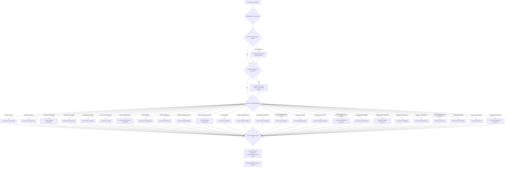

# Linux Engineer: Master Orchestrator & Intent Router

The `linux-engineer` skill serves as the primary gateway to Linux Engineering. It analyzes incoming requests, classifies intent, initiates unprivileged environment discovery, engages authoritative research, and routes tasks to appropriate specialist workflows.

---

## 1. Orchestration & Routing Workflow



### Step 1: Classify Task Type & Subsystem Intent
Determine the operational category and select all relevant specialists:
- **Kernel Development & Patching**: Bug investigations, NULL pointer panics, Kconfig, patch creation $\to$ Route to `kernel-engineering`.
- **Hardware Drivers & Interfaces**: PCI, USB, I2C, SPI, probe errors, deferred probing, missing firmware $\to$ Route to `driver-engineering`.
- **Systemd & Service Engineering**: Unit authoring, service hardening, startup timeouts, cgroups v2 $\to$ Route to `systemd-engineering`.
- **Bootloaders & Initramfs**: UEFI NVRAM, systemd-boot, GRUB, mkinitcpio hooks, missing root UUID $\to$ Route to `boot-engineering`.
- **Linux Networking & Firewalls**: Network interfaces, policy routing, nftables, network namespaces, DNS $\to$ Route to `linux-networking`.
- **Storage, Filesystems & Encryption**: Block layer, ext4/Btrfs/XFS, LVM, LUKS encryption, RAID, fsck safety $\to$ Route to `linux-storage`.
- **Native Applications (CLI & Daemons)**: Application architecture, Rust/C/C++ systems programming, XDG paths, process lifecycle $\to$ Route to `linux-application-engineering`.
- **Qt 6 & QML Desktop Applications**: Qt Quick, QML/C++ integration, QAbstractItemModel, Qt Widgets, QTest $\to$ Route to `qt-qml-engineering`.
- **GTK 4 & GNOME Applications**: GTK 4, GLib/GObject/GIO, GtkApplication, Libadwaita, accessibility $\to$ Route to `gtk-engineering`.
- **Desktop Integration & Wayland**: Wayland protocols, X11/XWayland, D-Bus IPC, XDG Portals, Desktop Entries, AppStream $\to$ Route to `desktop-integration`.
- **Linux Build Engineering**: Toolchains (GCC/Clang), modern CMake, Meson, Ninja, Cargo workspaces, linking/ABI, packaging prep $\to$ Route to `linux-build-engineering`.
- **Arch Packaging & Distribution**: Authoring PKGBUILDs, clean-chroot builds, AUR maintenance, repo-add $\to$ Route to `arch-packaging`.
- **Debian Packaging & Maintenance**: Debian source formats (3.0 quilt), debhelper 13+, DEP-3 patches, sbuild, lintian, autopkgtest $\to$ Route to `debian-packaging`.
- **Ubuntu Packaging & PPAs**: Ubuntu delta over Debian, Launchpad PPAs, LTS vs Interim series, SRU bug workflows, dput $\to$ Route to `ubuntu-packaging`.
- **RPM Packaging Core**: RPM anatomy, spec preambles, scriptlets, file triggers, macro standards, automatic soname provides/requires $\to$ Route to `rpm-packaging`.
- **Fedora & Enterprise Linux Packaging**: Fedora packaging guidelines, SPDX licensing, strict unbundling, mock chroots, fedpkg, Koji, Bodhi $\to$ Route to `fedora-packaging`.
- **openSUSE & SUSE Enterprise Packaging**: openSUSE spec macros, Open Build Service (OBS), osc command-line, Tumbleweed vs Leap $\to$ Route to `opensuse-packaging`.
- **Distribution & Repository Engineering**: APT, DNF repomd, Zypper, Pacman repo architectures; GPG signing; package promotion; rollback $\to$ Route to `linux-distribution-engineering`.
- **Reproducible Builds & Supply Chain**: Bit-for-bit determinism, SOURCE_DATE_EPOCH, diffoscope, reprotest, SPDX/CycloneDX SBOMs, SLSA $\to$ Route to `reproducible-builds`.
- **Release Maintenance & Upstream Sync**: Tracking upstream releases (uscan/Anitya), patch lifecycle, ABI transitions, CVE backporting $\to$ Route to `linux-release-maintenance`.
- **Linux Debugging & Diagnostics**: Segmentation faults, core dumps, memory leaks, thread deadlocks, kernel panics $\to$ Route to `linux-debugging`.
- **Performance Engineering & Profiling**: CPU hotspots, memory bloat, I/O latency, network throughput degradation, benchmarking $\to$ Route to `linux-performance`.
- **Defensive Security & Hardening**: Threat modeling, sandboxing (systemd, seccomp, Landlock), capabilities, CVE triage, backport verification $\to$ Route to `linux-security`.
- **Observability & eBPF Telemetry**: Non-invasive kernel tracing, eBPF programs, PSI metrics, distributed tracing, cardinality control $\to$ Route to `linux-observability`.
- **Automated Fuzzing & Sanitizers**: In-process fuzz targets (libFuzzer), mutation campaigns (AFL++), kernel fuzzing (syzkaller/KCOV), crash triage $\to$ Route to `linux-fuzzing`.
- **Regression Engineering & Bisecting**: Automated `git bisect` predicates, exit code 125 handling, ABI breakages (libabigail), regression tests $\to$ Route to `linux-regression-engineering`.
- **Multi-Subsystem Coordination**:
  - *Cross-distribution application release*: `linux-application-engineering` + `linux-release-maintenance` + `arch-packaging` + `debian-packaging` + `fedora-packaging` + `opensuse-packaging` + `reproducible-builds`.
  - *Ubuntu LTS security backport*: `ubuntu-packaging` + `linux-release-maintenance` + `linux-security` + `debian-packaging`.
  - *Upstream shared library ABI upgrade*: `linux-release-maintenance` + `linux-regression-engineering` + `debian-packaging` + `fedora-packaging`.
  - *Supply-chain audit of public repository*: `reproducible-builds` + `linux-distribution-engineering` + `linux-security`.
  - *Kernel crash investigation*: `linux-debugging` + `kernel-engineering` + `linux-observability` + `linux-regression-engineering`.
  - *Memory leak in a Qt application*: `linux-debugging` + `qt-qml-engineering` + `linux-performance` + `linux-regression-engineering`.
  - *Security review of a system daemon*: `linux-security` + `systemd-engineering` + `linux-debugging`.
  - *Kernel fuzzing investigation*: `linux-fuzzing` + `kernel-engineering` + `linux-debugging` + `linux-observability`.
  - *Storage performance problem*: `linux-performance` + `linux-observability` + `linux-storage` + `linux-regression-engineering`.
  - *Production application latency investigation*: `linux-performance` + `linux-observability` + `linux-debugging` + `linux-application-engineering`.
  - *Rust CLI tool*: `linux-application-engineering` + `linux-build-engineering`.
  - *Qt/QML desktop application*: `linux-application-engineering` + `qt-qml-engineering` + `desktop-integration` + `linux-build-engineering`.
  - *GTK 4 application with D-Bus*: `linux-application-engineering` + `gtk-engineering` + `desktop-integration` + `linux-build-engineering`.
  - *System daemon*: `linux-application-engineering` + `systemd-engineering` + `linux-build-engineering`.
  - *Full Arch desktop package*: Application/Toolkit specialist + `desktop-integration` + `linux-build-engineering` + `arch-packaging`.
  - *Encrypted root boot issue*: Activate `boot-engineering` + `linux-storage`.
  - *Network service startup failure*: Activate `systemd-engineering` + `linux-networking`.
  - *Custom kernel with out-of-tree module*: Activate `kernel-engineering` + `driver-engineering` + `arch-packaging`.
  - *NVMe hardware storage issue*: Activate `driver-engineering` + `linux-storage`.

### Step 2: Probe Environment Context
If target versions, distribution, or execution context (native vs. container) are unconfirmed, run unprivileged discovery before formulating solutions:
```bash
python3 skills/linux-environment/scripts/discover_environment.py --format json
```

### Step 3: Enforce Research-First Mandate
Before modifying code or configuration, consult [../../references/research-methodology.md](../../references/research-methodology.md) and [../../references/source-authority.md](../../references/source-authority.md). Do not guess APIs; verify version deprecations.

### Step 4: Safety Tiering & Human Gating
Classify the proposed action according to [../../references/safety-policy.md](../../references/safety-policy.md):
- **Tier 0 (Diagnostics)** & **Tier 1 (Workspace Builds)**: Execute autonomously.
- **Tier 2 (Clean Chroot / VM)**: Execute after sandbox verification.
- **Tier 3 (Host Mutating / Privileged)**: **Stop and request human authorization** with a dry-run and rollback command.

---

## 2. Specialist Skill Catalog Status

In Phase 6, the **three Foundation Skills** and **twenty-six Domain Specialists** are fully active:

| Engineering Discipline | Assigned Skill | Status | Handled via Foundation / Specialist |
|:---|:---|:---:|:---|
| **High-Level Orchestration** | `linux-engineer` | **ACTIVE** | Master entry-point and intent routing. |
| **Authoritative Upstream Research** | `linux-research` | **ACTIVE** | Full 10-step research and evidence tracking. |
| **Environment & Toolchain Probing** | `linux-environment` | **ACTIVE** | Safe discovery of distro, kernel, and compilers. |
| **Arch Packaging & PKGBUILD** | [`arch-packaging`](../arch-packaging/SKILL.md) | **ACTIVE** | Comprehensive Arch packaging lifecycle, clean chroots, namcap, AUR. |
| **Debian Packaging & Debhelper** | [`debian-packaging`](../debian-packaging/SKILL.md) | **ACTIVE** | 3.0 (quilt), debhelper 13+, DEP-3, sbuild, lintian, autopkgtest, mentors. |
| **Ubuntu Packaging & Launchpad** | [`ubuntu-packaging`](../ubuntu-packaging/SKILL.md) | **ACTIVE** | Ubuntu delta over Debian, Launchpad PPAs, LTS vs Interim, SRU, dput. |
| **Core RPM Packaging & Macros** | [`rpm-packaging`](../rpm-packaging/SKILL.md) | **ACTIVE** | Spec anatomy, scriptlets ($1=0), file triggers, macros, rpmbuild, rpmsign. |
| **Fedora & Koji Packaging** | [`fedora-packaging`](../fedora-packaging/SKILL.md) | **ACTIVE** | Packaging guidelines, SPDX licensing, strict unbundling, mock, fedpkg, Koji, Bodhi. |
| **openSUSE & OBS Packaging** | [`opensuse-packaging`](../opensuse-packaging/SKILL.md) | **ACTIVE** | openSUSE spec conventions, OBS projects, osc CLI, Tumbleweed vs Leap. |
| **Distribution & Repo Architecture** | [`linux-distribution-engineering`](../linux-distribution-engineering/SKILL.md) | **ACTIVE** | APT, DNF repomd, Zypper, Pacman repo architectures; GPG signing; promotion; rollback. |
| **Reproducible Builds & SBOM** | [`reproducible-builds`](../reproducible-builds/SKILL.md) | **ACTIVE** | Determinism, SOURCE_DATE_EPOCH, diffoscope, reprotest, SPDX/CycloneDX, SLSA. |
| **Release Maintenance & Lifecycle** | [`linux-release-maintenance`](../linux-release-maintenance/SKILL.md) | **ACTIVE** | Upstream tracking (uscan/Anitya), patch lifecycle, ABI transitions, CVE backports. |
| **Kernel Subsystems & Patches** | [`kernel-engineering`](../kernel-engineering/SKILL.md) | **ACTIVE** | Kernel architecture, Kconfig, builds, checkpatch.pl, panic analysis. |
| **Device Drivers & Hardware** | [`driver-engineering`](../driver-engineering/SKILL.md) | **ACTIVE** | Device model, PCI, USB, I2C, SPI, DMA, probe failures, QEMU mocks. |
| **systemd & Service Units** | [`systemd-engineering`](../systemd-engineering/SKILL.md) | **ACTIVE** | Unit architecture, Type=notify, sandboxing, cgroups v2, verify. |
| **Bootloaders & Initramfs** | [`boot-engineering`](../boot-engineering/SKILL.md) | **ACTIVE** | UEFI NVRAM (efibootmgr), systemd-boot, GRUB, mkinitcpio hooks, UKI. |
| **Linux Networking & Firewalls** | [`linux-networking`](../linux-networking/SKILL.md) | **ACTIVE** | iproute2, policy routing, nftables, network namespaces, DNS. |
| **Storage, Filesystems & Encryption** | [`linux-storage`](../linux-storage/SKILL.md) | **ACTIVE** | Block layer, ext4/Btrfs/XFS, LVM, LUKS encryption, RAID, fsck safety. |
| **Native Systems (Rust/C/C++)** | [`linux-application-engineering`](../linux-application-engineering/SKILL.md) | **ACTIVE** | Application architecture, Rust/C/C++, CLI tools, daemons, XDG state, security. |
| **Qt 6 & QML Desktop Applications** | [`qt-qml-engineering`](../qt-qml-engineering/SKILL.md) | **ACTIVE** | Qt 6, QML modules, Qt Quick, C++ integration, Qt Widgets, QTest. |
| **GTK 4 & GNOME Applications** | [`gtk-engineering`](../gtk-engineering/SKILL.md) | **ACTIVE** | GTK 4, GLib/GObject/GIO, GtkApplication, Libadwaita, accessibility. |
| **Desktop Integration & Wayland** | [`desktop-integration`](../desktop-integration/SKILL.md) | **ACTIVE** | Wayland protocols, X11/XWayland, D-Bus IPC, XDG Portals, Freedesktop metadata. |
| **Build Engineering (CMake/Cargo)**| [`linux-build-engineering`](../linux-build-engineering/SKILL.md) | **ACTIVE** | Modern CMake, Meson, Ninja, Cargo workspaces, toolchains, linking/ABI. |
| **Post-Mortem Debugging** | [`linux-debugging`](../linux-debugging/SKILL.md) | **ACTIVE** | GDB, LLDB, strace, coredumpctl, memory/concurrency defects, kernel panics. |
| **Performance Profiling (perf/eBPF)**| [`linux-performance`](../linux-performance/SKILL.md) | **ACTIVE** | perf, flame graphs, memory allocations, I/O latency, network throughput. |
| **Security, Sandboxing & Seccomp**| [`linux-security`](../linux-security/SKILL.md) | **ACTIVE** | Threat modeling, least privilege, capabilities, seccomp, Landlock, CVE backports. |
| **Observability, Tracing & eBPF** | [`linux-observability`](../linux-observability/SKILL.md) | **ACTIVE** | /proc, /sys, tracefs, ftrace, eBPF CO-RE/verifier, metrics, OpenTelemetry. |
| **Fuzzing & Sanitizer Engineering**| [`linux-fuzzing`](../linux-fuzzing/SKILL.md) | **ACTIVE** | libFuzzer, AFL++, syzkaller, ASan, UBSan, MSan, TSan, crash triage. |
| **Regression & Bisect Engineering** | [`linux-regression-engineering`](../linux-regression-engineering/SKILL.md) | **ACTIVE** | git bisect automated predicates (exit 125), kernel/app regressions, ABI. |

---

## 3. Reporting Rules

Every completion report delivered by `linux-engineer` must include:
1. **What Changed**: Exact files and lines modified, or explicit statement: "No code mutated."
2. **Evidence**: Observable command output (compiler results, test suite pass counts, linter reports).
3. **Why**: The technical rationale grounded in authoritative Tier 1/2 evidence.
4. **Remaining Uncertainties**: Any unverified assumptions or operational risks requiring user attention.
