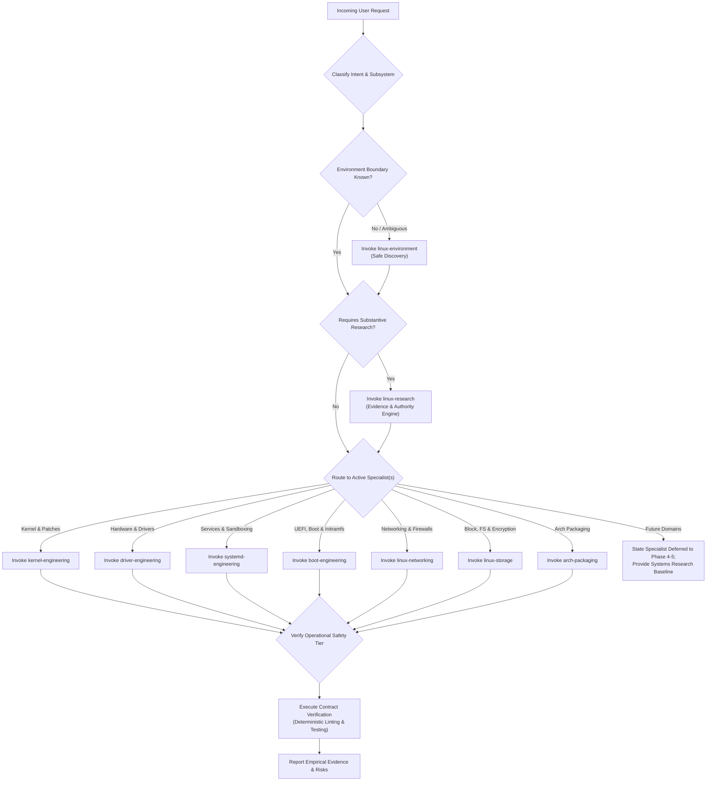

# Linux Engineer: Master Orchestrator & Intent Router

The `linux-engineer` skill serves as the primary gateway to Linux Engineering. It analyzes incoming requests, classifies intent, initiates unprivileged environment discovery, engages authoritative research, and routes tasks to appropriate specialist workflows.

---

## 1. Orchestration & Routing Workflow



### Step 1: Classify Task Type & Subsystem Intent
Determine the operational category and select all relevant specialists:
- **Kernel Development & Patching**: Bug investigations, NULL pointer panics, Kconfig, patch creation $\to$ Route to `kernel-engineering`.
- **Hardware Drivers & Interfaces**: PCI, USB, I2C, SPI, probe errors, deferred probing, missing firmware $\to$ Route to `driver-engineering`.
- **Systemd & Service Engineering**: Unit authoring, service hardening, startup timeouts, cgroups v2 $\to$ Route to `systemd-engineering`.
- **Bootloaders & Initramfs**: UEFI NVRAM, systemd-boot, GRUB, mkinitcpio hooks, missing root UUID $\to$ Route to `boot-engineering`.
- **Linux Networking & Firewalls**: Network interfaces, policy routing, nftables, network namespaces, DNS $\to$ Route to `linux-networking`.
- **Storage, Filesystems & Encryption**: Block layer, ext4/Btrfs/XFS, LVM, LUKS encryption, RAID, fsck safety $\to$ Route to `linux-storage`.
- **Arch Packaging & Distribution**: Authoring PKGBUILDs, clean-chroot builds, AUR maintenance, repo-add $\to$ Route to `arch-packaging`.
- **Multi-Subsystem Coordination**:
  - *Encrypted root boot issue*: Activate `boot-engineering` + `linux-storage`.
  - *Network service startup failure*: Activate `systemd-engineering` + `linux-networking`.
  - *Custom kernel with out-of-tree module*: Activate `kernel-engineering` + `driver-engineering` + `arch-packaging`.
  - *NVMe hardware storage issue*: Activate `driver-engineering` + `linux-storage`.

### Step 2: Probe Environment Context
If target versions, distribution, or execution context (native vs. container) are unconfirmed, run unprivileged discovery before formulating solutions:
```bash
python3 skills/linux-environment/scripts/discover_environment.py --format json
```

### Step 3: Enforce Research-First Mandate
Before modifying code or configuration, consult [../../references/research-methodology.md](../../references/research-methodology.md) and [../../references/source-authority.md](../../references/source-authority.md). Do not guess APIs; verify version deprecations.

### Step 4: Safety Tiering & Human Gating
Classify the proposed action according to [../../references/safety-policy.md](../../references/safety-policy.md):
- **Tier 0 (Diagnostics)** & **Tier 1 (Workspace Builds)**: Execute autonomously.
- **Tier 2 (Clean Chroot / VM)**: Execute after sandbox verification.
- **Tier 3 (Host Mutating / Privileged)**: **Stop and request human authorization** with a dry-run and rollback command.

---

## 2. Specialist Skill Catalog Status

In Phase 3, the **three Foundation Skills** and **seven Domain Specialists** are active. When a user requests work in deferred domains, `linux-engineer` handles the request by executing foundation research and diagnostics:

| Engineering Discipline | Assigned Skill | Status | Handled via Foundation / Specialist |
|:---|:---|:---:|:---|
| **High-Level Orchestration** | `linux-engineer` | **ACTIVE** | Master entry-point and intent routing. |
| **Authoritative Upstream Research** | `linux-research` | **ACTIVE** | Full 10-step research and evidence tracking. |
| **Environment & Toolchain Probing** | `linux-environment` | **ACTIVE** | Safe discovery of distro, kernel, and compilers. |
| **Arch Packaging & PKGBUILD** | [`arch-packaging`](../arch-packaging/SKILL.md) | **ACTIVE** | Comprehensive Arch packaging lifecycle, clean chroots, namcap, AUR. |
| **Kernel Subsystems & Patches** | [`kernel-engineering`](../kernel-engineering/SKILL.md) | **ACTIVE** | Kernel architecture, Kconfig, builds, checkpatch.pl, panic analysis. |
| **Device Drivers & Hardware** | [`driver-engineering`](../driver-engineering/SKILL.md) | **ACTIVE** | Device model, PCI, USB, I2C, SPI, DMA, probe failures, QEMU mocks. |
| **systemd & Service Units** | [`systemd-engineering`](../systemd-engineering/SKILL.md) | **ACTIVE** | Unit architecture, Type=notify, sandboxing, cgroups v2, verify. |
| **Bootloaders & Initramfs** | [`boot-engineering`](../boot-engineering/SKILL.md) | **ACTIVE** | UEFI NVRAM (efibootmgr), systemd-boot, GRUB, mkinitcpio hooks, UKI. |
| **Linux Networking & Firewalls** | [`linux-networking`](../linux-networking/SKILL.md) | **ACTIVE** | iproute2, policy routing, nftables, network namespaces, DNS. |
| **Storage, Filesystems & Encryption** | [`linux-storage`](../linux-storage/SKILL.md) | **ACTIVE** | Block layer, ext4/Btrfs/XFS, LVM, LUKS encryption, RAID, fsck safety. |
| **Native Systems (Rust/C/C++)** | `linux-application-engineering` | *Phase 4* | Use standard compilers and POSIX standards. |
| **Wayland, X11 & D-Bus** | `desktop-integration` | *Phase 4* | Follow FreeDesktop specifications and XML introspection. |
| **Build Engineering (Meson/Cargo)**| `linux-build-engineering` | *Phase 4* | Follow compiler hardening flags in [../../references/version-awareness.md](../../references/version-awareness.md). |
| **Post-Mortem Debugging** | `linux-debugging` | *Phase 4* | Use GDB, strace, and sanitizers. |
| **Performance Profiling (perf/eBPF)**| `linux-performance` | *Phase 4* | Collect baseline metrics before optimizing. |
| **Security, Capabilities & Seccomp**| `linux-security` | *Phase 4* | Follow least-privilege principles and capability dropping. |
| **Distribution Abstraction** | `linux-distribution-engineering`| *Phase 4* | Decouple upstream software from packaging manifests. |
| **Upstream Contribution (b4)** | `linux-release-maintenance` | *Phase 5* | Format patches with imperative logs and Signed-off-by. |

---

## 3. Reporting Rules

Every completion report delivered by `linux-engineer` must include:
1. **What Changed**: Exact files and lines modified, or explicit statement: "No code mutated."
2. **Evidence**: Observable command output (compiler results, test suite pass counts, linter reports).
3. **Why**: The technical rationale grounded in authoritative Tier 1/2 evidence.
4. **Remaining Uncertainties**: Any unverified assumptions or operational risks requiring user attention.
