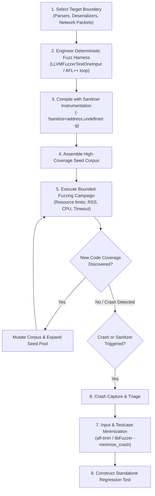

# Linux Fuzzing Specialist

The `linux-fuzzing` skill guides AI agents through systematic automated testing, input generation, coverage-guided fuzzing, and crash triage across user-space libraries, parsers, protocols, and the Linux kernel.

---

## 1. Coverage-Guided Fuzzing Lifecycle

### The 8-Step Fuzzing Discipline:
1. **Target Selection**: Prioritize untrusted input boundaries: file parsers, serialization libraries, cryptographic decoders, network packet dissectors, and kernel syscall interfaces.
2. **Harness Engineering**: Author deterministic, stateless, high-throughput in-process test harnesses (`LLVMFuzzerTestOneInput`).
3. **Sanitizer Integration**: Combine coverage instrumentation with compiler sanitizers (AddressSanitizer + UndefinedBehaviorSanitizer) to trap subtle memory corruption immediately.
4. **Seed Corpus Assembly**: Curate minimal, valid initial test files that maximize code path coverage.
5. **Campaign Execution**: Run fuzzers under explicit memory ceilings (`-rss_limit_mb=2048`) and execution timeouts (`-timeout=5`).
6. **Crash Triage**: Distinguish out-of-memory timeouts from genuine security defects (UAF, buffer overflow, assertion failures).
7. **Input Minimization**: Minimize crashing input bytes to the absolute smallest byte sequence that triggers the crash.
8. **Regression Test Conversion**: Convert minimized inputs into permanent unit tests integrated into CI test suites.

---

## 2. Fuzzing Engine Matrix

| Fuzzing Engine | Primary Use Case | Execution Model | Performance / Throughput |
|---|---|---|---|
| **libFuzzer** | Library functions, API fuzzing, parser functions | In-process, single-threaded or worker pool | Very High (1,000 - 50,000 exec/sec) |
| **AFL++** | CLI binaries, file-based applications, complex state | Out-of-process fork-server or persistent mode | Moderate to High (500 - 5,000 exec/sec) |
| **Honggfuzz** | Multi-threaded targets, hardware-feedback fuzzing | Thread-based, hardware counter feedback | High |
| **syzkaller** | Linux kernel system calls, drivers, filesystems | Distributed across isolated QEMU/KVM VMs | Dependent on VM boot and kernel execution |

---

## 3. Operational Safety Boundaries

- **Tier 0 (Diagnostics)**: Writing harness source code, inspecting crash dumps, and minimizing inputs inside the workspace is fully autonomous.
- **Tier 1 (Workspace Builds)**: Compiling test harnesses with `-fsanitize=fuzzer,address` in the workspace runs autonomously.
- **Tier 3 (Host Mutating / Privileged)**: Running syzkaller on bare metal host or fuzzing live third-party network services is strictly prohibited.
- **Isolated Kernel Fuzzing**: Kernel fuzzing must strictly execute inside disposable, ephemeral virtual machines (QEMU/KVM), never on the user's host OS.

---

## 4. Reference Library

- [fuzzing-methodology.md](references/fuzzing-methodology.md) — Coverage-guided fuzzing, edge coverage bitmaps, and mutation strategies.
- [userspace-fuzzing.md](references/userspace-fuzzing.md) — libFuzzer and AFL++ workflows, flags, and persistent mode.
- [kernel-fuzzing.md](references/kernel-fuzzing.md) — syzkaller architecture, `syz-lang` descriptions, KCOV, and QEMU isolation.
- [fuzz-harnesses.md](references/fuzz-harnesses.md) — Writing deterministic, leak-free, high-throughput fuzz targets.
- [sanitizers.md](references/sanitizers.md) — ASan, UBSan, MSan, TSan, KASAN: capabilities, performance overhead, and mutual exclusion.
- [corpus-management.md](references/corpus-management.md) — Seed corpus curation, dictionary authoring, and `afl-cmin` minimization.
- [crash-triage.md](references/crash-triage.md) — Deduplication, stack trace analysis, input minimization (`afl-tmin`), and CVE conversion.
