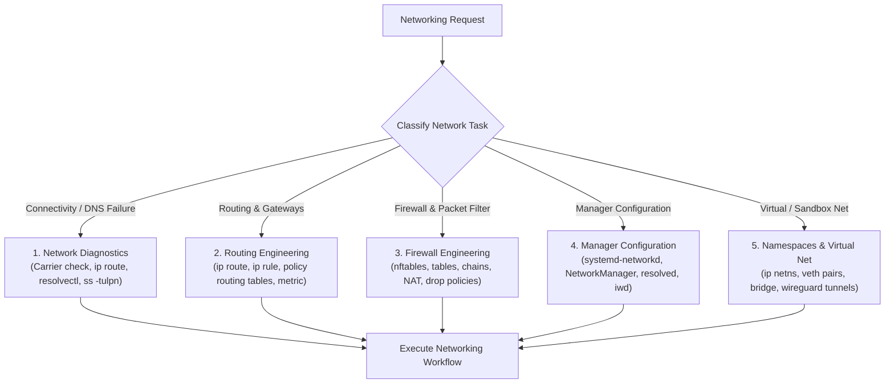

# Linux Networking Engineering

The `linux-networking` skill provides specialist capabilities for analyzing, configuring, and troubleshooting the Linux networking stack, `iproute2` interfaces, policy routing, `nftables` firewalls, network managers, and isolated network namespaces.

---

## 1. Operating Principles & Invariants

1. **Manager Non-Concurrency Invariant**: Never run `NetworkManager` and `systemd-networkd` concurrently on the same interface. Dual managers produce race conditions, route flapping, and conflicting DHCP leases.
2. **Layered Diagnostic Discipline**: Follow the 7-stage OSI diagnostic sequence (Carrier $\to$ IP $\to$ Route $\to$ DNS $\to$ Firewall $\to$ Socket $\to$ Path). Never blame DNS without verifying IP routing first.
3. **Never Expose Secrets in Reports**: Redact Wi-Fi pre-shared keys, WireGuard private keys, and authentication credentials from diagnostic command outputs.
4. **Safety Tier Gating**: Modifying host IP addresses, altering routing tables, flushing firewall rules (`nft flush ruleset`), and toggling network interfaces are Tier 3 operations requiring explicit human authorization. Use isolated network namespaces for safe testing.

---

## 2. Intent Classification & Workflow Routing

---

## 3. The 7-Stage Diagnostic Workflow

1. **Layer 1 (Carrier)**: Verify physical/virtual link carrier status with `ip link show` and `ethtool`.
2. **Layer 2 (Neighbor)**: Check ARP/NDP resolution with `ip neigh show`.
3. **Layer 3 (Addressing)**: Check IP assignment and subnet mask with `ip -br addr show`.
4. **Layer 3 (Routing)**: Verify default gateway and route selection with `ip route get <destination>`.
5. **Layer 4 (Sockets)**: Inspect listening ports and socket state with `ss -tulpn`.
6. **Layer 4 (Firewall)**: Check `nft list ruleset` for drop policies or missing accept rules.
7. **Layer 7 (Name Resolution)**: Query DNS reachability with `resolvectl status` and `resolvectl query`.

---

## 4. Cross-Specialist Coordination

| Task | Coordinating Specialists | Interaction |
|:---|:---|:---|
| Network-activated service | `linux-networking` + `systemd-engineering` | `linux-networking` configures interface; `systemd-engineering` wires `Type=notify` / sockets. |
| NIC driver failure | `linux-networking` + `driver-engineering` | `linux-networking` checks carrier/ethtool; `driver-engineering` diagnoses PCI/DMA faults. |

---

## 5. Authoritative References Directory

- [Networking Architecture & Stack](references/networking-architecture.md)
- [Network Configuration & Managers](references/network-configuration.md)
- [Routing & Policy-Based Routing](references/routing-and-policy.md)
- [nftables & Firewall Engineering](references/nftables.md)
- [Network Namespaces & Virtual Networking](references/namespaces-and-virtualization.md)
- [Network Diagnostics & Troubleshooting](references/troubleshooting.md)
- [Safety Policy](../../references/safety-policy.md)
