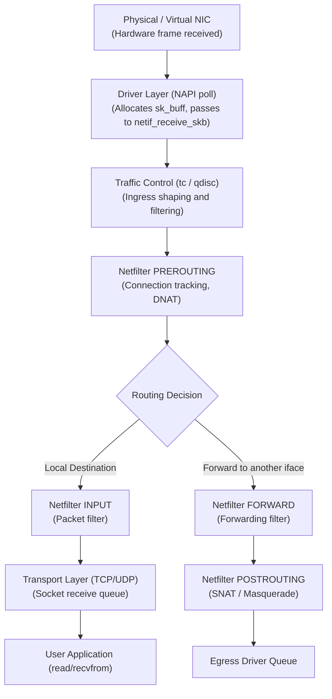

# Linux Networking Architecture Reference

## 1. Scope

This document details the Linux kernel networking stack, `sk_buff` packet processing, Netlink IPC, interface naming, and socket architectures.

---

## 2. Kernel Networking Stack Architecture

---

## 3. Predictable Network Interface Names

Systemd and udev assign deterministic network interface names based on hardware firmware topologies:
- `enp3s0`: Ethernet on PCI bus 3, slot 0.
- `wlan0` / `wlp2s0`: Wireless interface on PCI bus 2, slot 0.
- `ibp1s0`: InfiniBand interface.
- `veth0`: Virtual ethernet pair endpoint.
- `br0`: Software bridge interface.

---

## 4. Netlink Socket IPC

The kernel and userspace communicate network state changes over Netlink (`NETLINK_ROUTE` family):
- `iproute2` utilities (`ip link`, `ip addr`, `ip route`) issue Netlink requests rather than legacy `ioctl` calls.
- Events like interface down/up or IP address renewal trigger broadcast notifications to listeners (`systemd-networkd`, `NetworkManager`).

---

## 5. Authoritative References

- [Linux Networking Documentation](https://docs.kernel.org/networking/index.html)
- [Predictable Network Interface Names](https://systemd.io/PREDICTABLE_INTERFACE_NAMES/)
