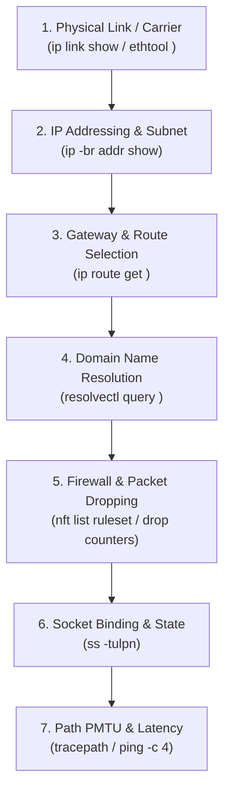

# Network Diagnostics & Troubleshooting Reference

## 1. Scope

This document details the 7-stage OSI-aligned network diagnostic procedure, failure isolation, and socket troubleshooting.

---

## 2. The 7-Stage Diagnostic Sequence

Never jump to conclusions (e.g., blaming DNS for a cable disconnect). Execute diagnostics from Layer 1 through Layer 7:

---

## 3. Diagnostic Commands Reference

| Diagnostic Layer | Command | Verification Check |
|:---|:---|:---|
| **Layer 1: Link & Carrier** | `ip link show enp3s0` | State must be `UP` and `LOWER_UP`. Carrier detected via `ethtool enp3s0` (`Link detected: yes`). |
| **Layer 2: Neighbor Cache** | `ip neigh show` | Resolves MAC addresses via ARP/NDP. Check for `FAILED` or `STALE`. |
| **Layer 3: IP Address** | `ip -br addr show` | Interface has valid non-APIPA (not `169.254.x.x`) IP and correct netmask. |
| **Layer 3: Routing** | `ip route get 8.8.8.8` | Verifies that a default gateway exists and prints the outgoing interface and metric. |
| **Layer 4: Socket Listening** | `ss -tulpn` | Checks if daemon is listening on `0.0.0.0` or bound strictly to `127.0.0.1`. |
| **Layer 4: Firewall Drops** | `nft list ruleset` | Checks if firewall policy is `drop` and rules lack matching accept clauses. |
| **Layer 7: DNS Lookup** | `resolvectl status` | Checks upstream DNS reachability and latency. |

---

## 4. Differentiating DNS vs. Routing Failures

- **DNS Failure Test**:
  - `ping 1.1.1.1` succeeds $\to$ Network routing and gateway are operational.
  - `ping archlinux.org` fails $\to$ DNS resolution failure. Focus on `systemd-resolved` or `/etc/resolv.conf`.
- **Routing Failure Test**:
  - `ping 1.1.1.1` returns `connect: Network is unreachable` $\to$ No default route configured in routing table.
  - Check `ip route show`.

---

## 5. Authoritative References

- [ip(8) Manual](https://man.archlinux.org/man/ip.8)
- [ss(8) Manual](https://man.archlinux.org/man/ss.8)
- [ethtool(8) Manual](https://man.archlinux.org/man/ethtool.8)
