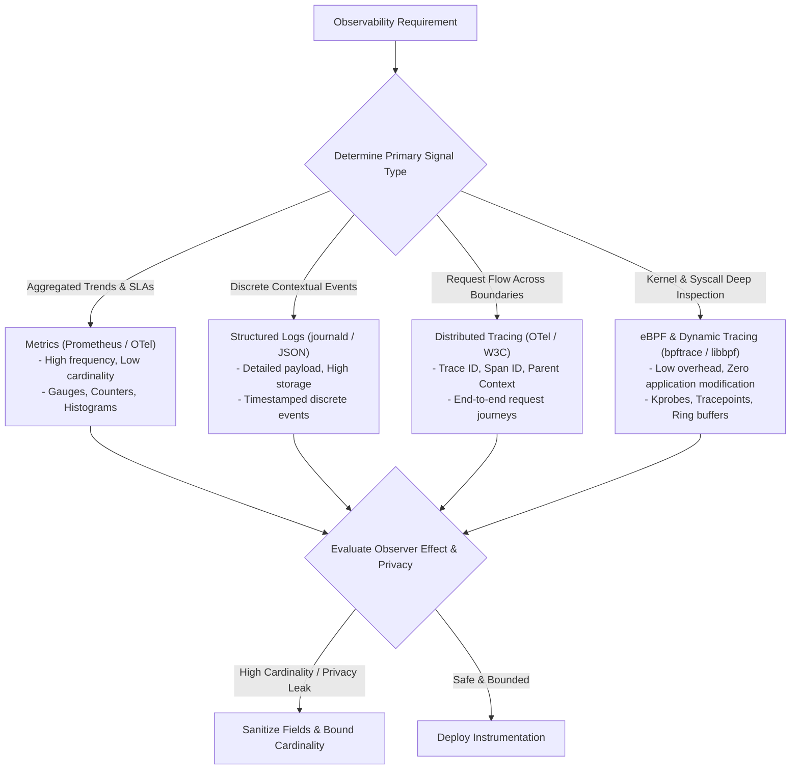

# Linux Observability Specialist

The `linux-observability` skill guides AI agents through system-wide and application-level observability on Linux using native kernel interfaces, eBPF, structured telemetry, and tracing.

---

## 1. Observability Signal Triad & Workflow

### The 4 Pillars of Observability:
1. **Metrics**: Aggregatable numeric measurements over time intervals. Perfect for alerting, dashboards, and error rates. Low storage footprint when cardinality is controlled.
2. **Logs**: Append-only timestamped records of discrete events. Carries rich context (user IDs, error messages, parameters).
3. **Traces**: Directed acyclic graphs of spans tracking a single execution transaction as it traverses threads, processes, and network microservices.
4. **Dynamic Profiling / Tracing (eBPF)**: Non-invasive, in-kernel probe execution tracking kernel functions, syscall latency, lock contention, and I/O events without modifying binary sources.

---

## 2. Linux Native Tracing Interfaces

| Interface | Path / Mechanism | Capability | Overhead & Safety |
|---|---|---|---|
| **tracefs** | `/sys/kernel/tracing` | Built-in ftrace engine, function graphs, tracepoints | Negligible when disabled; modest when tracing filtered events |
| **Kernel Tracepoints** | `TRACE_EVENT` macros in kernel code | Stable ABI hooks into kernel subsystems (sched, net, block) | Zero overhead when disabled; highly stable across kernel versions |
| **Kprobes / Kretprobes** | Dynamic kernel instruction breakpointing | Instruments any non-inlined kernel function | Moderate overhead; probe points may shift across kernel updates |
| **Uprobes / Uretprobes** | User-space instruction breakpointing | Instruments user-space functions in shared libraries and executables | Higher overhead (trap to kernel); useful for tracing SSL/TLS and glibc |
| **eBPF (BPF)** | `bpf(2)` system call + JIT compiler | Executes sandboxed bytecode directly inside kernel event loops | Fast in-kernel processing; verifier prevents crashes |

---

## 3. Operational Safety Boundaries

- **Tier 0 (Diagnostics)**: Reading `/proc/stat`, `/proc/loadavg`, `/proc/pressure/*` (PSI), and journal logs is fully autonomous.
- **Tier 3 (Host Mutating / Privileged)**: Loading eBPF programs into the kernel (`bpf(2)`), attaching kprobes, modifying `/sys/kernel/tracing`, or deploying system-wide audit rules requires explicit human authorization.
- **Privacy & Secret Protection**: Never log raw cryptographic keys, authorization headers (`Bearer ...`), credit card numbers, or passwords in observability pipelines.

---

## 4. Reference Library

- [observability-methodology.md](references/observability-methodology.md) — Four signal pillars, RED vs USE metrics, and cardinality control.
- [linux-native-observability.md](references/linux-native-observability.md) — `/proc`, `/sys`, tracefs, cgroups v2, and Pressure Stall Information (PSI).
- [perf-and-tracing.md](references/perf-and-tracing.md) — ftrace, tracepoints, kprobes, uprobes, and trace-cmd.
- [ebpf-architecture.md](references/ebpf-architecture.md) — BPF verifier, program types, maps, BTF, CO-RE, and ring buffers.
- [libbpf-and-bpftrace.md](references/libbpf-and-bpftrace.md) — Authoring bpftrace scripts, libbpf skeletons, and troubleshooting verifier rejections.
- [metrics-and-telemetry.md](references/metrics-and-telemetry.md) — Prometheus counters/gauges/histograms, OpenTelemetry collectors, and cardinality traps.
- [distributed-tracing.md](references/distributed-tracing.md) — W3C Trace Context, spans, context propagation, and sampling strategies.
- [privacy-and-overhead.md](references/privacy-and-overhead.md) — The Observer Effect, CPU/memory overhead, data redaction, and compliance.
