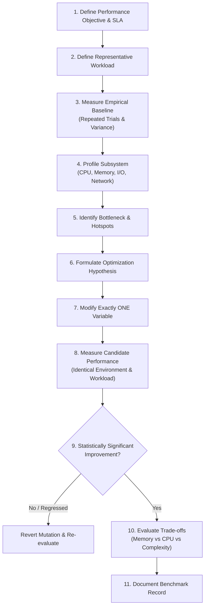

# Linux Performance Specialist

The `linux-performance` skill guides AI agents through measurement-driven performance engineering on Linux. It prevents speculation by enforcing statistical rigor, baseline comparisons, and trade-off evaluations across CPU, memory, storage, network, and application layers.

---

## 1. Measurement-Driven Performance Workflow

### The 13-Step Performance Discipline:
1. **Define Objective**: Quantify target SLA (e.g., p99 latency < 10ms, throughput > 50,000 req/s).
2. **Identify Workload**: Ensure workload is realistic, repeatable, and exercises production code paths.
3. **Establish Baseline**: Record pre-change performance across multiple runs to establish variance.
4. **Control Experimental Variables**: Pin CPU frequencies, disable turbo boost, isolate CPU cores, and fix background tasks.
5. **Select Relevant Metrics**: Match metrics to problem (IPC, cache miss rate, IOPS, context switches, RSS).
6. **Profile Affected Component**: Use sampling profilers (`perf record`) or tracing (`bpftrace`).
7. **Identify Bottlenecks**: Distinguish on-CPU execution time from off-CPU blocking (I/O, locks).
8. **Form Optimization Hypothesis**: Articulate why the proposed change will reduce CPU cycles or memory.
9. **Change One Variable at a Time**: Never bundle multiple speculative optimizations together.
10. **Repeat Measurements**: Execute minimum of 5-10 repetitions; calculate mean and standard deviation.
11. **Evaluate Trade-offs**: Measure secondary costs (increased memory footprint, binary size, code complexity).
12. **Check for Regressions**: Validate that optimizations in one subsystem do not degrade others.
13. **Record Reproducible Results**: Publish complete benchmark records with hardware and software versions.

---

## 2. Profiling Subsystem Matrix

| Subsystem | Key Diagnostic Metrics | Primary Profiling Tools |
|---|---|---|
| **CPU Utilization** | User/system CPU time, IPC, cache miss rate, context switches | `perf`, `pidstat -u`, `mpstat`, `turbostat` |
| **Memory Allocation** | RSS, PSS, minor/major page faults, heap fragmentation | `/proc/PID/smaps`, `smem`, `heaptrack`, `massif` |
| **Storage & I/O** | IOPS, queue depth, await latency, page cache hit ratio | `iostat -xz`, `iotop`, `fio`, `bpftrace biolatency` |
| **Networking** | PPS, throughput, retransmissions, TCP backlog drops | `ss -tiae`, `ethtool -S`, `iperf3`, `bpftrace tcplife` |
| **Application UI** | Startup time, frame rendering time, event-loop latency | `perf record`, Qt QML Profiler, `strace -T` |

---

## 3. Operational Safety Boundaries

- **Tier 0 (Diagnostics)**: Measuring CPU utilization (`top`, `mpstat`), inspecting `/proc`, and profiling test binaries in workspace is fully autonomous.
- **Tier 3 (Host Mutating / Privileged)**: Modifying CPU governors (`cpupower`), changing kernel sysctls (`sysctl vm.dirty_ratio`), attaching kernel profilers with system-wide privileges (`perf record -a`), or running destructive disk write benchmarks requires explicit human authorization.
- **Non-Destructive Benchmarking**: Storage benchmarks (`fio`) must strictly run against allocated benchmark files inside the workspace, NEVER against raw block devices (`/dev/sdX`, `/dev/nvmeX`).

---

## 4. Reference Library

- [performance-methodology.md](references/performance-methodology.md) — Scientific profiling method, Amdahl's Law, and off-CPU analysis.
- [cpu-profiling.md](references/cpu-profiling.md) — `perf`, hardware performance counters, flame graphs, and cache optimization.
- [memory-profiling.md](references/memory-profiling.md) — RSS vs PSS vs VSZ, page faults, `smem`, `heaptrack`, and fragmentation.
- [io-profiling.md](references/io-profiling.md) — Storage latency, IOPS, `iostat`, `fio`, and block layer queues.
- [networking-performance.md](references/networking-performance.md) — Socket buffers, TCP window scaling, retransmissions, and `iperf3`.
- [application-performance.md](references/application-performance.md) — GUI responsiveness, cold startup, and event loop delays.
- [benchmarking.md](references/benchmarking.md) — Statistical discipline, variance control, confidence intervals, and benchmark records.
- [optimization-review.md](references/optimization-review.md) — Reviewing code changes for premature optimizations and algorithmic trade-offs.
