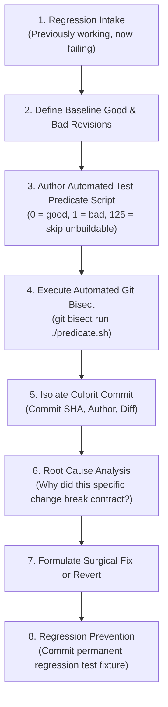

# Linux Regression Engineering Specialist

The `linux-regression-engineering` skill guides AI agents through identifying, isolating, and preventing regressions across Linux kernel patches, drivers, system services, native applications, and shared libraries.

---

## 1. Regression Engineering Workflow

### The 8-Step Regression Isolation Process:
1. **Define Baseline State**: Establish known good commit/version and known bad commit/version.
2. **Confirm Clean Reproducibility**: Verify failure is deterministic rather than a flaky test or timing race.
3. **Write Automated Predicate**: Create a standalone bash script that builds the commit and evaluates the behavior.
4. **Handle Build Failures Correctly**: Crucial invariant: if a commit fails to compile during bisect, return exit code 125 (`git bisect skip`), NEVER return 1 (which falsely flags it as bad) or 0 (which falsely flags it as good).
5. **Execute Binary Search**: Run `git bisect run ./predicate.sh` to isolate the culprit commit in $O(\log N)$ steps.
6. **Analyze Culprit Diff**: Inspect commit message and exact code delta to understand intended vs accidental side-effects.
7. **Remediate**: Propose a targeted patch or revert that restores compatibility.
8. **Lock In Prevention**: Add permanent regression test cases to the project test suite.

---

## 2. Regression Classification Matrix

| Regression Class | Primary Symptoms | Diagnostic & Isolation Tool |
|---|---|---|
| **Functional Logic** | Feature previously worked; now returns incorrect data or error | `git bisect`, unit tests, minimal reproducers |
| **Crash / Panic** | Previously stable code crashes with SIGSEGV or kernel panic | `git bisect`, GDB core analysis, KASAN |
| **Performance** | Throughput dropped by >10% or latency spiked | `hyperfine`, `perf stat`, benchmark history |
| **ABI / API Incompatibility** | Existing client binaries fail to run with dynamic linker error | `abidiff` (libabigail), `readelf` |
| **Kernel Subsystem** | Hardware driver fails to probe or suspend/resume breaks across kernel update | QEMU kernel bisect, `git bisect` on torvalds/linux |

---

## 3. Operational Safety Boundaries

- **Tier 0 (Diagnostics)**: Running `git log`, `git blame`, inspecting diffs, and checking ABI with `abidiff` is fully autonomous.
- **Tier 1 (Workspace Builds)**: Running automated bisect scripts in workspace copies or git worktrees runs autonomously.
- **Tier 3 (Host Mutating / Privileged)**: Replacing running host kernel packages or host glibc to test regressions requires explicit human authorization. Use isolated VMs or chroots for regression verification.

---

## 4. Reference Library

- [regression-methodology.md](references/regression-methodology.md) — Defining regressions, establishing baselines, and isolating causes.
- [git-bisect.md](references/git-bisect.md) — Automated predicates, handling unbuildable commits (125), and worktrees.
- [kernel-regressions.md](references/kernel-regressions.md) — Bisecting the Linux kernel, QEMU boot testing, and Linus's "Never break userspace" rule.
- [application-regressions.md](references/application-regressions.md) — Behavioral regressions, configuration migration, and unit test preservation.
- [performance-regressions.md](references/performance-regressions.md) — Statistical regression thresholds, noise handling, and automated benchmark gates.
- [abi-compatibility.md](references/abi-compatibility.md) — Shared library ABI stability, SONAME rules, vtables, and libabigail (`abidiff`).
- [regression-prevention.md](references/regression-prevention.md) — Golden test fixtures, CI regression matrices, and regression corpora.
