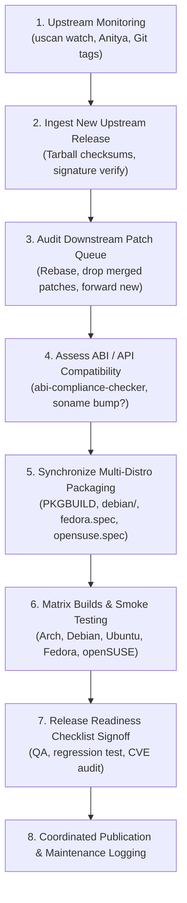

# Linux Release Maintenance Specialist

The `linux-release-maintenance` skill guides AI agents through the end-to-end lifecycle of tracking upstream software, managing downstream patch queues, synchronizing releases across multiple Linux distributions, coordinating shared library ABI transitions, and executing security backports for Long Term Support (LTS) releases.

---

## 1. Multi-Distribution Release Maintenance Lifecycle

### The 8-Step Release Maintenance Discipline:
1. **Automate Upstream Tracking**: Monitor upstream release feeds, GitHub/GitLab releases, and registry indices using tools like Debian `uscan` or release-monitoring.org.
2. **Verify Upstream Integrity**: Validate cryptographic signatures (GPG/Cosign) and release hashes before unpacking new tarballs.
3. **Audit and Prune Downstream Patches**: Evaluate every downstream patch against the new release; drop patches accepted upstream, rebase necessary local deltas, and document reasons.
4. **Enforce Semantic ABI Tracking**: Check for breaking library ABI/API changes using `abi-dumper` and `abi-compliance-checker`; coordinate soname bumps and transitional packages when needed.
5. **Harmonize Multi-Distribution Metadata**: Keep package metadata, license expressions, and build dependencies aligned across Arch Linux, Debian, Ubuntu, Fedora, and openSUSE.
6. **Execute Matrix Smoke Testing**: Compile and run test suites across target distributions using containers or VMs prior to committing changes.
7. **Complete Release Readiness Review**: Verify changelogs, upgrade paths, bug fix verifications, and security impact before tagging or uploading.
8. **Document Maintenance History**: Maintain clean, distribution-compliant changelogs and forward all bug fixes upstream with DEP-3 or upstream Git PRs.

---

## 2. Multi-Distribution Packaging Layout Comparison

| Distribution | Packaging Directory / File | Patch Management System | Changelog Format |
|---|---|---|---|
| **Arch Linux** | `PKGBUILD` | In-tree `source=(...)` + `prepare()` | Git commit history or `.INSTALL` |
| **Debian / Ubuntu** | `debian/` (`control`, `rules`) | Quilt (`debian/patches/series`) | `debian/changelog` (strict format) |
| **Fedora** | `<name>.spec` | Git / `Patch0: ...` / `%autosetup -p1` | `%changelog` or `%autochangelog` |
| **openSUSE** | `<name>.spec` + `<name>.changes` | `Patch0: ...` / `%autosetup -p1` | `<name>.changes` (RFC 822 format) |

---

## 3. Operational Safety Boundaries

- **Tier 0 (Diagnostics)**: Checking upstream watch status (`uscan --dry-run`), comparing git tags, auditing patch series, and analyzing ABI compatibility reports is fully autonomous.
- **Tier 1 (Workspace Builds)**: Rebasing patch queues, updating spec/PKGBUILD files in workspace branches, and executing test builds runs autonomously.
- **Tier 3 (Host Mutating / Upstream Releasing)**: Pushing tags to upstream remotes, uploading packages to distribution archives (Mentors, Launchpad, Koji, OBS), or filing official SRUs strictly requires explicit human authorization.

---

## 4. Reference Library

- [upstream-tracking.md](references/upstream-tracking.md) — Release monitoring tools, `debian/watch`, Anitya, and Git tag verification.
- [patch-maintenance.md](references/patch-maintenance.md) — Patch lifecycle, DEP-3 headers, rebasing strategies, and upstream forwarding.
- [multi-distro-maintenance.md](references/multi-distro-maintenance.md) — Maintaining unified software across Arch, Debian, Ubuntu, Fedora, and openSUSE.
- [abi-transitions.md](references/abi-transitions.md) — Soname bumps, ABI compliance tooling, and transitional library packaging.
- [security-maintenance.md](references/security-maintenance.md) — CVE tracking, CVSS scoring, minimal backporting, and security advisories.
- [release-readiness.md](references/release-readiness.md) — Formal Go/No-Go checklists, regression testing, and signoff criteria.
- [lifecycle-management.md](references/lifecycle-management.md) — Long Term Support (LTS) policies, End of Life (EOL) tracking, and sunsetting.