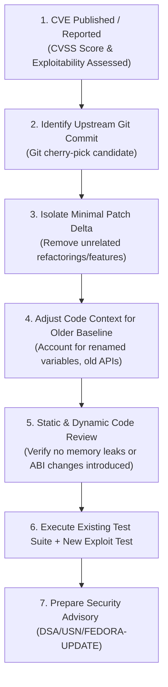

# Security Maintenance & CVE Backporting

Maintaining stable Linux distributions and enterprise appliances requires backporting security fixes without upgrading entire software stacks or destabilizing working systems.

---

## 1. Security Maintenance Invariant

> **Never introduce new features or change public APIs in a security update.**

In stable releases (e.g., Debian Stable, Ubuntu LTS, RHEL, openSUSE Leap), users expect zero regressions. Upgrading from `myapp 1.2.3` to `myapp 2.0.0` just to fix a security bug is strictly forbidden. The security fix must be isolated into a minimal patch and backported to `1.2.3`.

---

## 2. The CVE Backporting Discipline



### Key Practices:
1. **Locate Upstream Fix**: Find the exact commit in the upstream repository fixing the vulnerability.
2. **Cherry-Pick**:
   ```bash
   git cherry-pick -x <commit-sha>
   ```
3. **Resolve Conflicts Carefully**: Do NOT casually adapt new upstream APIs that do not exist in the older baseline. If upstream refactored code prior to fixing the bug, write a targeted minimal fix matching the older codebase structure.
4. **Author Regression Test**: Add a test case reproducing the vulnerability prior to the patch and verifying the fix after the patch.

---

## 3. Security Advisory Metadata

Every security update must document:
- **CVE Identifiers**: e.g., `CVE-2026-12345`.
- **Vulnerability Description**: Buffer overflow, race condition, unauthorized privilege escalation.
- **Affected Versions**: `myapp < 1.2.4`.
- **Fixed Package Version**: `myapp 1.2.3-1+deb12u1` or `myapp-1.2.3-2.fc40`.
- **Credits & Upstream References**.