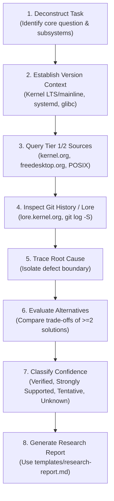

# Linux Research: Evidence-Based Engineering Investigation

The `linux-research` skill enforces the core philosophy: **Research before implementation. Evidence before assumptions. Verification before completion.**

Ordinary AI agents frequently hallucinate obsolete APIs, quote unverified forum snippets, or make premature code changes. This skill replaces guesswork with a systematic, 10-step investigation workflow grounded in official upstream documentation and source repositories.

---

## 1. The Investigation Workflow

When activated, execute these steps in order:

### Step 1: Deconstruct the Problem
- Identify the affected Linux layers: hardware interface, kernel driver, core kernel, init system (`systemd`), C library (`glibc`), or desktop/display server.
- Formulate precise, searchable technical questions (e.g., "What replaced `init_timer()` in Linux 4.14?", "Does `ProtectSystem=strict` make `/etc` read-only?").

### Step 2: Establish Version Context
- Probe or verify the active version boundary using `linux-environment` or provided user context.
- Never apply advice written for an older kernel (e.g., 4.x/5.x) to a modern 6.x kernel without verifying whether APIs have been deprecated or removed. See [../../references/version-awareness.md](../../references/version-awareness.md).

### Step 3: Query Authoritative Sources
- Query sources strictly adhering to the 7-tier authority hierarchy in [references/upstream-sources.md](references/upstream-sources.md) and [../../references/source-authority.md](../../references/source-authority.md).
- Search upstream documentation (`docs.kernel.org`, `freedesktop.org/software/systemd/man/`, `man7.org`).
- **Disqualification Rule**: Never treat search-engine snippets, blog posts, or StackOverflow comments as authoritative proof.

### Step 4: Upstream Code & Git History Inspection
- When documentation is silent or ambiguous, inspect the source code directly.
- Use `git log -S` and `git log -p` to understand *why* an API or configuration directive was changed.
- For kernel regressions, search `lore.kernel.org` archives for public-inbox commit discussions.

### Step 5: Root-Cause Analysis
- Distinguish between symptoms and root causes.
- Do not propose invasive code refactors when the problem is an environmental misconfiguration, permission defect, or missing build dependency.

### Step 6: Evaluate Technical Alternatives
- Formulate at least two alternative approaches to solve the problem.
- Document trade-offs (performance, maintainability, backward compatibility, security) in an alternatives table.

### Step 7: Assess Evidence Confidence
- Categorize every finding according to the 4 confidence levels defined in [references/confidence-levels.md](references/confidence-levels.md):
  - **Verified**: Confirmed in source code, formal standard, or reproducible test.
  - **Strongly Supported**: Documented in official upstream manual or maintainer notes.
  - **Tentative**: Inferred from secondary patterns; requires testing.
  - **Unknown**: Insufficient evidence; state the limitation honestly.

### Step 8: Produce Structured Output
- For substantive investigations, produce a research report using [templates/research-report.md](templates/research-report.md).
- For quick technical answers, output an evidence card using [templates/evidence-card.md](templates/evidence-card.md).

---

## 2. Proportionate Research Principle

Match the research depth to the operational risk of the task:
- **Low Risk (Configuration / Minor API lookup)**: Targeted query against Tier 1 man pages or documentation; output a concise evidence card.
- **Medium Risk (Service hardening, packaging, IPC)**: Query upstream manuals, verify target systemd/distro version, check for deprecations, provide alternatives table.
- **High Risk (Kernel patch, driver concurrency, bootloader, memory corruption)**: Complete 10-step protocol, upstream git commit inspection, lore.kernel.org regression check, full research report with rollback commands.
