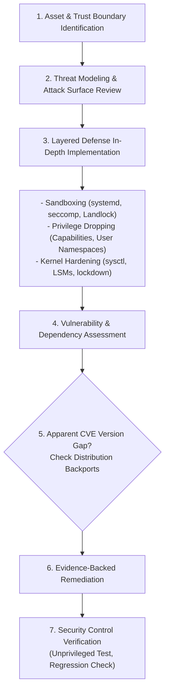

# Linux Security Specialist

The `linux-security` skill guides AI agents through defensive security engineering, architecture reviews, sandboxing, vulnerability investigation, and hardening on Linux.

---

## 1. Defensive Security Lifecycle

### The 7-Step Defensive Security Process:
1. **Identify Assets & Trust Boundaries**: Enumerate sensitive data, network sockets, IPC interfaces, and administrative privileges.
2. **Conduct Threat Modeling**: Map threats using STRIDE or attack trees; identify entry points and potential privilege escalation paths.
3. **Enforce Least Privilege**: Never execute software as `root` when a restricted service user or capability set suffices.
4. **Implement Defense in Depth**: Combine compiler mitigations (stack canaries, ASLR, PIE, FORTIFY_SOURCE), sandboxing (seccomp, Landlock), and service confinement (systemd directives).
5. **Investigate Vulnerabilities Accurately**: Never assume a package is vulnerable based solely on upstream version strings. Cross-reference package changelogs and distribution security trackers to verify backported security fixes.
6. **Remediate Deficiencies**: Apply minimal, verifiable security patches that preserve functional requirements.
7. **Verify Security Invariants**: Test that unauthorized actions fail with `EPERM` or `EACCES` while legitimate operations succeed.

---

## 2. Linux Security Controls Matrix

| Security Layer | Primary Linux Mechanisms | Diagnostic / Audit Commands |
|---|---|---|
| **Process Privileges** | POSIX Capabilities, ambient capabilities, user namespaces | `getpcaps <PID>`, `capsh --print` |
| **System Call Filtering** | Seccomp-BPF, `PR_SET_NO_NEW_PRIVS` | `grep Seccomp /proc/<PID>/status` (0: none, 1: strict, 2: filter) |
| **Filesystem Isolation** | Landlock, Mount namespaces, `ProtectSystem=strict` | `systemd-analyze security <service>` |
| **Mandatory Access Control** | AppArmor, SELinux, Landlock | `aa-status`, `sestatus` |
| **Binary Hardening** | PIE, RELRO, Stack Canary, NX/DEP, Control Flow Integrity | `checksec --file=<path>` |
| **Kernel Hardening** | `kptr_restrict`, `dmesg_restrict`, Kernel Lockdown, Yama | `sysctl kernel.yama.ptrace_scope` |

---

## 3. Operational Safety Boundaries

- **Tier 0 (Diagnostics)**: Auditing service permissions (`systemd-analyze security`), inspecting `/proc/<PID>/status`, checking binary flags with `checksec`, and reviewing source code is fully autonomous.
- **Tier 3 (Host Mutating / Privileged)**: Modifying firewall rules (`nftables`, `iptables`), altering kernel sysctls (`sysctl -w`), changing file ownerships in `/etc`, or modifying PAM/shadow configurations requires explicit human authorization.
- **Defensive Scope Only**: Never generate exploit payloads, buffer overflow exploit strings, or bypass authentication controls. Security reviews must remain strictly defensive and remedial.

---

## 4. Reference Library

- [threat-modeling.md](references/threat-modeling.md) — Asset mapping, trust boundaries, STRIDE, and attack surfaces.
- [linux-security-architecture.md](references/linux-security-architecture.md) — Capabilities, namespaces, seccomp, LSMs, and Landlock.
- [privilege-separation.md](references/privilege-separation.md) — Dropping root, capability bounding, and systemd sandboxing.
- [kernel-security.md](references/kernel-security.md) — Kernel lockdown, sysctl hardening, eBPF security, and module signing.
- [application-security.md](references/application-security.md) — Memory safety, injection, path traversal, symlink attacks, and temp files.
- [filesystem-security.md](references/filesystem-security.md) — File permissions, ACLs, mount flags (`noexec`, `nosuid`), and encryption.
- [network-security.md](references/network-security.md) — Socket exposure, TLS configuration, firewall boundaries, and network namespaces.
- [vulnerability-research.md](references/vulnerability-research.md) — CVE triage, distribution backport verification, and severity scoring.
- [remediation.md](references/remediation.md) — Patch engineering, validation, regression prevention, and security disclosures.
