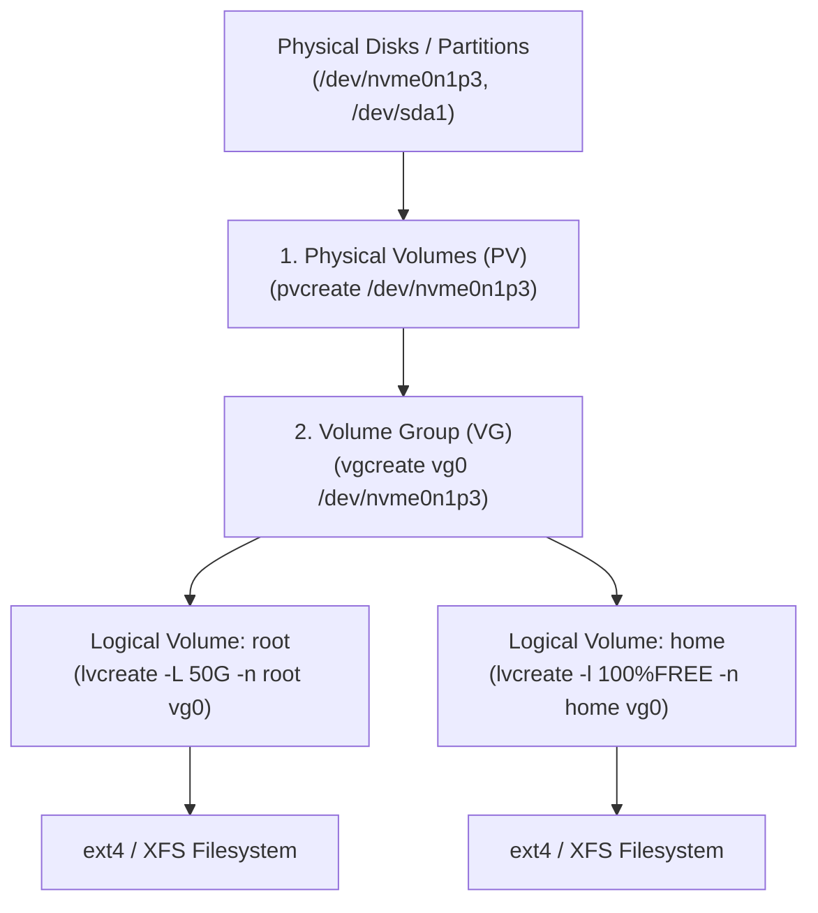

# Device Mapper & LVM Reference

## 1. Scope

This document details the Device Mapper (DM) kernel framework and Logical Volume Manager (LVM) architectures, volume groups, logical volumes, and online resizing.

---

## 2. Device Mapper Architecture

Device Mapper is a kernel framework that maps physical block devices into virtual block devices (`/dev/mapper/*`). Targets include:
- `linear`: Concatenates physical partitions.
- `striped`: Software striping (RAID 0).
- `crypt`: Cryptographic transparent encryption (LUKS / dm-crypt).
- `snapshot`: Copy-on-Write block level snapshots.
- `thin`: Thin-provisioned storage pools.

---

## 3. LVM (Logical Volume Manager) Hierarchy



---

## 4. Volume Resizing Operations

```bash
# 1. Extend an LVM Logical Volume by 20GB and resize ext4 filesystem simultaneously
lvextend -L +20G -r /dev/vg0/root

# 2. For XFS filesystems (resize while mounted):
lvextend -L +20G /dev/vg0/root
xfs_growfs /
```

---

## 5. Authoritative References

- [Device Mapper Kernel Documentation](https://docs.kernel.org/admin-guide/device-mapper/index.html)
- [LVM Administrator Guide](https://sourceware.org/lvm2/)
- [ArchWiki: LVM](https://wiki.archlinux.org/title/LVM)
