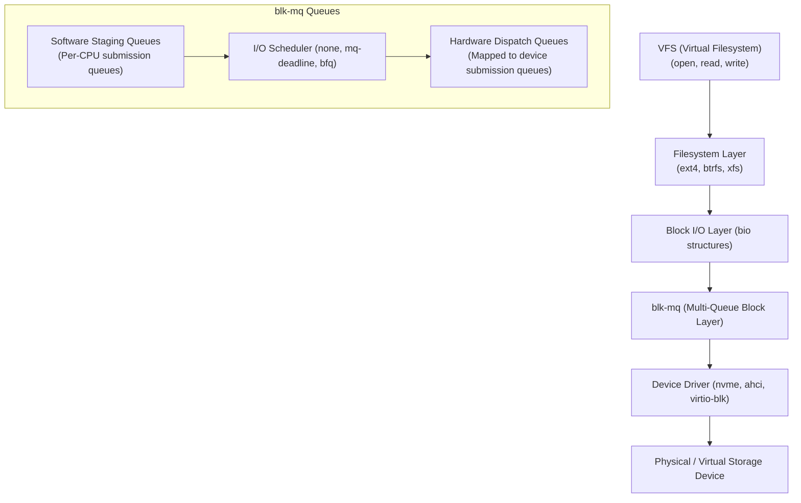

# Linux Storage Architecture & Block Layer Reference

## 1. Scope

This document details the Linux storage architecture, block layer (`blk-mq`), I/O schedulers, device interfaces (NVMe, SATA, virtio), and discard/TRIM operations.

---

## 2. Block Layer Architecture

---

## 3. Storage Hardware Interfaces

| Interface | Device Node | Linux Driver | Performance Profile |
|:---|:---|:---|:---|
| **NVMe** (PCIe) | `/dev/nvme0n1` | `drivers/nvme/host/` | Massive parallel hardware queues (up to 64k queues, 64k depth per queue). Default scheduler: `none`. |
| **SATA / SAS** | `/dev/sda` | `drivers/ata/` (`ahci`), `libata` | Single hardware command queue (NCQ, 32 depth). Schedulers: `mq-deadline`, `bfq`. |
| **virtio-blk** | `/dev/vda` | `drivers/block/virtio_blk.c` | Paravirtualized block queue for KVM/QEMU guests. |

---

## 4. I/O Schedulers Selection

Configured via `/sys/block/<device>/queue/scheduler`:
- **`none`**: Bypasses scheduler; directly dispatches from software queues to hardware queues. Recommended for ultra-fast NVMe SSDs.
- **`mq-deadline`**: Enforces strict latency deadlines to prevent request starvation. Recommended for SATA SSDs.
- **`bfq` (Budget Fair Queueing)**: Optimizes interactive desktop responsiveness and fair bandwidth distribution. Recommended for rotational HDDs.

---

## 5. Discard & TRIM Operations (`fstrim`)

Solid-state drives require TRIM/discard commands to notify the flash controller of deleted blocks:
- **Periodic TRIM (Recommended)**: Enable `fstrim.timer` (executes weekly).
- **Continuous TRIM (`-o discard`)**: Discouraged on most SATA drives due to synchronous queue flushing overhead; acceptable on modern asynchronous NVMe.

---

## 6. Authoritative References

- [Linux Block Layer Documentation](https://docs.kernel.org/block/index.html)
- [NVMe Driver Documentation](https://docs.kernel.org/driver-api/nvme.html)
