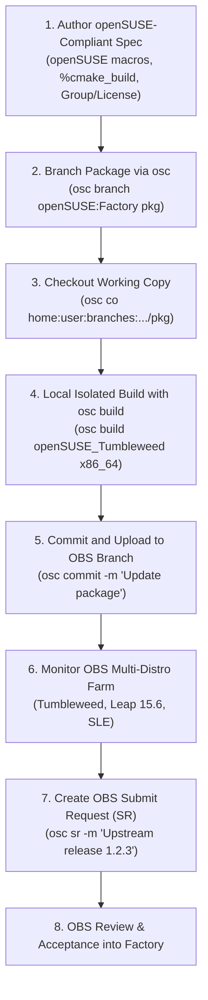

# openSUSE Packaging Specialist

The `opensuse-packaging` skill guides AI agents through openSUSE and SUSE Linux Enterprise package engineering, Open Build Service (OBS) project architectures, and the `osc` development lifecycle.

---

## 1. openSUSE / OBS Development Workflow

### The 8-Step openSUSE Packaging Discipline:
1. **Adhere to openSUSE Guidelines**: Use openSUSE RPM macros (`%cmake_build`, `%make_install`, `%systemd_ordering`), license conventions, and proper RPM Group categories.
2. **Branch Package via `osc`**: Branch packages from `openSUSE:Factory` or `openSUSE:Leap` into personal home project (`osc branch`).
3. **Execute Local Builds**: Test compilation locally in a clean VM or chroot using `osc build openSUSE_Tumbleweed x86_64`.
4. **Reconcile Leap vs Tumbleweed**: Account for distribution variances (rolling Tumbleweed with bleeding-edge GCC vs stable Leap aligned with SUSE Linux Enterprise).
5. **Manage Source Services**: Use OBS source services (`_service`) for automated upstream tarball fetching and verification where appropriate.
6. **Submit to OBS Remote**: Push spec, patches, and source files to your OBS project (`osc commit`).
7. **Monitor Build Status**: Verify that the package compiles cleanly across all target distributions and architectures (`osc results`).
8. **File Submit Requests (`osc sr`)**: Submit clean changes back to `openSUSE:Factory` with descriptive maintenance changelog entries.

---

## 2. openSUSE vs Fedora RPM Distinctions

| Feature / Convention | Fedora Packaging | openSUSE Packaging |
|---|---|---|
| **Build Macros** | `%cmake_build`, `%meson_build` | `%cmake_build` or `%make_build`, `%meson_build` |
| **Systemd Integration** | `%systemd_post`, `%systemd_preun` | `%service_add_post`, `%service_del_preun` |
| **CLI Client** | `fedpkg` | `osc` (Open Build Service client) |
| **Build Farm** | Koji (Fedora only) | Open Build Service (Multi-distribution: openSUSE, SLE, Fedora, Debian, Arch) |
| **Rolling Release** | Rawhide (unstable trunk) | Tumbleweed (fully tested, openQA-gated rolling release) |
| **Enterprise Base** | RHEL (downstream from Fedora) | SLE (Leap shares exact binary packages with SLE) |

---

## 3. Operational Safety Boundaries

- **Tier 0 (Diagnostics)**: Querying OBS build logs (`osc results`, `osc log`), inspecting openSUSE spec files, and checking openQA results is fully autonomous.
- **Tier 1 (Workspace Builds)**: Running local builds (`osc build`) inside clean workspace chroots runs autonomously.
- **Tier 3 (Host Mutating / Privileged)**: Submitting official Submit Requests (`osc sr`) to `openSUSE:Factory`, publishing packages to production OBS projects, or altering host Zypper repositories strictly requires explicit human authorization.

---

## 4. Reference Library

- [opensuse-policy.md](references/opensuse-policy.md) — openSUSE Packaging Guidelines, license categories, and spec rules.
- [opensuse-spec-conventions.md](references/opensuse-spec-conventions.md) — Spec macros (`%service_add_post`, `%cmake_build`, `pkgconfig()`).
- [osc.md](references/osc.md) — The `osc` command-line interface (checkout, update, build, submit).
- [obs-projects.md](references/obs-projects.md) — Open Build Service project architectures and meta configuration.
- [obs-builds.md](references/obs-builds.md) — Local vs remote builds, architecture configurations, and log troubleshooting.
- [obs-repositories.md](references/obs-repositories.md) — Multi-distribution targets (Tumbleweed, Leap, SLE) and repository chaining.
- [opensuse-maintenance.md](references/opensuse-maintenance.md) — Factory submission, openQA integration, and Leap backports.
