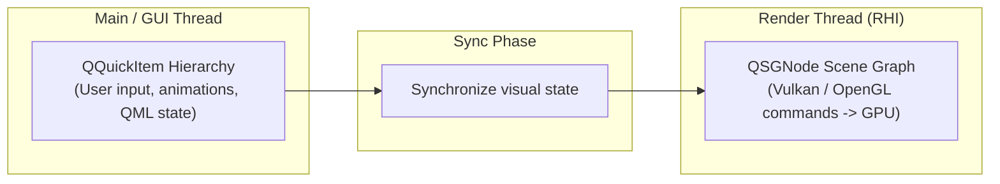

# Qt Quick Scene Graph & Visual Architecture

## 1. Scope & The Rendering Pipeline

Qt Quick is the visual presentation framework powered by QML. Unlike traditional widgets that use CPU-based rasterization, Qt Quick relies on a dedicated **Scene Graph** rendered via the **Qt Rendering Hardware Interface (RHI)** across Vulkan, OpenGL, or software backends on Linux.

---

## 2. The Scene Graph Architecture

Qt Quick strictly decouples the QML object tree from the rendering thread:
1. **GUI / Main Thread**:
   - Executes the QML engine, evaluates property bindings, handles user input (mouse, keyboard, touch), and maintains the `QQuickItem` tree.
2. **Render Thread**:
   - Manages GPU buffers, shader pipelines, and draws the `QSGNode` scene graph.
   - Updates occur during synchronized "sync" phases when the main thread is blocked for a few microseconds to copy visual state into scene graph nodes.



---

## 3. High-Performance Animations & Transitions

- **Prefer PropertyAnimation / NumberAnimation over Timers**:
  - Never use a `Timer` to manually increment a visual property (`x += 1`). Timers fire on the main thread and jitter under CPU load.
  - Use declarative animations (`NumberAnimation on x`, `ColorAnimation`, `Behavior on opacity`).
- **ParallelAnimation and SequentialAnimation**:
  - Combine multiple transitions declaratively:
    ```qml
    SequentialAnimation {
        id: fadeAndSlide
        NumberAnimation { target: banner; property: "opacity"; to: 1.0; duration: 250; easing.type: Easing.OutQuad }
        NumberAnimation { target: banner; property: "y"; to: 50; duration: 300; easing.type: Easing.OutBack }
    }
    ```

---

## 4. Input Handling: Gestures & Pointers

In Qt 6, legacy `MouseArea` is superseded by modular **Pointer Handlers**:
- **`TapHandler`**: Lightweight click/tap detection on any Item without stealing drag gestures.
- **`DragHandler`**: Multi-touch and mouse dragging with bounds constraints.
- **`WheelHandler`**: Smooth mouse wheel and trackpad scroll handling.
- **`HoverHandler`**: Efficient mouse-over tracking without forcing window hover polling.

```qml
Rectangle {
    id: card
    width: 200; height: 100
    color: tap.pressed ? "lightgray" : "white"

    TapHandler {
        id: tap
        onTapped: console.log("Card clicked!")
    }

    HoverHandler {
        id: hover
        cursorShape: Qt.PointingHandCursor
    }
}
```
