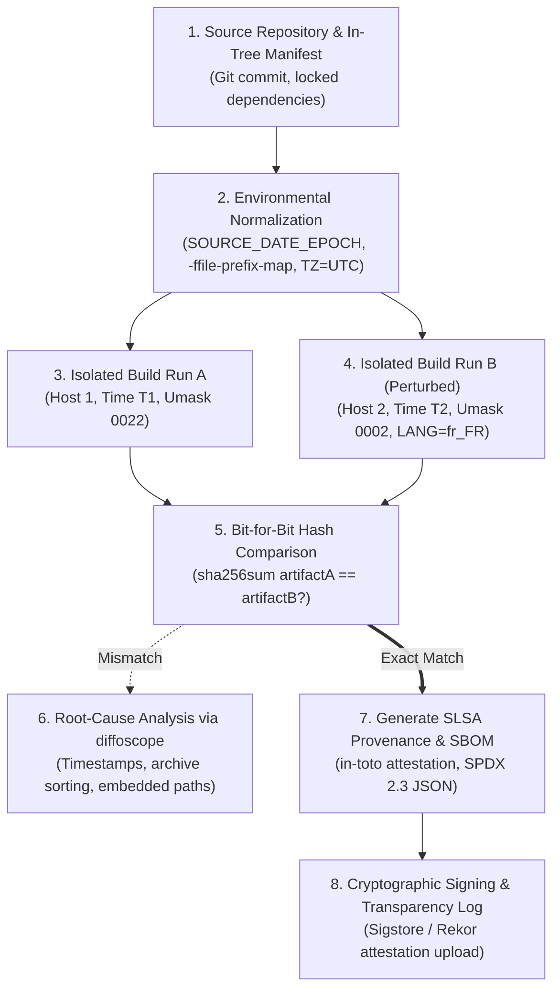

# Reproducible Builds & Supply-Chain Engineering Specialist

The `reproducible-builds` skill guides AI agents through achieving bit-for-bit deterministic compilation, eliminating environmental non-determinism, diagnosing binary mismatches with `diffoscope` and `reprotest`, generating standardized SBOMs (SPDX/CycloneDX), and implementing SLSA provenance attestations.

---

## 1. Reproducible Supply-Chain Verification Pipeline

### The 8-Step Reproducibility Discipline:
1. **Pin Build Environment**: Fix base container or chroot images, compiler versions, and toolchains.
2. **Normalize Clocks via `SOURCE_DATE_EPOCH`**: Set build timestamps to the last commit timestamp rather than current system wall-clock time.
3. **Eliminate Embedded Build Paths**: Compile with `-ffile-prefix-map=$(PWD)=.` or `-fdebug-prefix-map` to prevent local developer paths from polluting binary DWARF sections.
4. **Enforce Deterministic Archive Ordering**: Sort file lists prior to calling `tar`, `cpio`, or `zip`, and clamp archive file timestamps.
5. **Neutralize Locale and Sorting Variations**: Export `LC_ALL=C.UTF-8` and `TZ=UTC` across all build scripts.
6. **Execute Dual-Build Verification via `reprotest`**: Run automated multi-condition perturbation builds altering umask, kernel architecture strings, paths, and build times.
7. **Generate Standardized Machine-Readable SBOMs**: Produce SPDX or CycloneDX manifests documenting every direct and transitive dependency with cryptographic hashes.
8. **Publish Cryptographic Attestations**: Sign and publish in-toto provenance statements satisfying SLSA Build Level 3 requirements.

---

## 2. Common Sources of Non-Determinism & Mitigations

| Source of Variance | Symptom in Binary | Standard Engineering Mitigation |
|---|---|---|
| **System Wall Clocks** | `__DATE__`, `__TIME__`, tar mtimes differ | Export `SOURCE_DATE_EPOCH=$(git log -1 --pretty=%ct)` |
| **Filesystem Traversal Order** | Reordered archive contents or object symbol tables | Pipe file lists through `sort -z` or pass `--sort=name` to `tar` |
| **Absolute Build Directories** | DWARF debug sections contain `/home/builder/...` | Pass `-ffile-prefix-map=$PWD=.` to C/C++ compiler |
| **Umask Differences** | File permission bits differ (`0644` vs `0664`) | Pass `--mode=go=rX,u+rw` to tar, or run under `umask 0022` |
| **Compiler Randomness** | Anonymous symbols or randomized hash maps differ | Pass `-frandom-seed=<hash>` to GCC, or seed PRNGs |

---

## 3. Operational Safety Boundaries

- **Tier 0 (Diagnostics)**: Comparing binary packages with `diffoscope`, validating existing SBOMs (`spdx-tools`), and querying Rekor transparency logs is fully autonomous.
- **Tier 1 (Workspace Builds)**: Running clean perturbation builds with `reprotest` or local compiler wrappers runs autonomously.
- **Tier 3 (Cryptographic Attestation)**: Signing official SLSA provenance statements or publishing attestations to production transparency logs strictly requires explicit human authorization.

---

## 4. Reference Library

- [reproducibility-methodology.md](references/reproducibility-methodology.md) — Bit-for-bit reproducibility principles and multi-builder consensus.
- [deterministic-builds.md](references/deterministic-builds.md) — Eliminating embedded timestamps, macro hygiene, and archive normalization.
- [build-environments.md](references/build-environments.md) — Environment variables, compiler prefix maps, and timezone/locale constraints.
- [reprotest-diffoscope.md](references/reprotest-diffoscope.md) — Using `reprotest` CLI, interpreting `diffoscope` outputs, and triaging mismatches.
- [sbom.md](references/sbom.md) — SPDX and CycloneDX specifications, component relationships, and vulnerability tracking.
- [provenance.md](references/provenance.md) — SLSA frameworks (Levels 1–3), in-toto attestations, and builder identity verification.
- [supply-chain-security.md](references/supply-chain-security.md) — Binary transparency logs, Sigstore/Cosign, and detecting dependency confusion/poisoning.