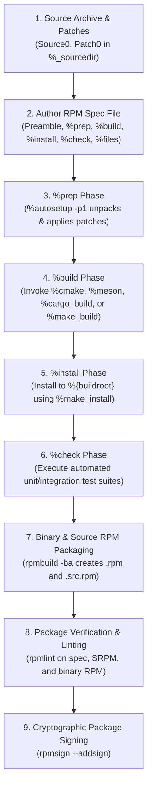

# RPM Packaging Specialist

The `rpm-packaging` skill guides AI agents through core RPM package engineering, spec file design, buildroot management, dependency generation, and package verification across all RPM-based Linux distributions.

---

## 1. RPM Build Lifecycle Workflow

### The 9-Step RPM Engineering Discipline:
1. **Acquire Upstream Artifacts**: Place upstream pristine source archives and cryptographically verified patches into `SOURCES/`.
2. **Author Spec Preamble**: Declare `Name`, `Version`, `Release`, `Summary`, `License` (SPDX format), `URL`, `BuildRequires`, and `Requires`.
3. **Configure `%prep` Stage**: Unpack sources and apply patches cleanly using `%autosetup -p1`.
4. **Compile in `%build` Stage**: Use standard distribution build macros (`%cmake`, `%meson`, `%cargo_build`, `%make_build`) which automatically inject platform compiler optimization and security hardening flags.
5. **Stage Files in `%install`**: Direct installation strictly into `%{buildroot}` (never touch host filesystem during build).
6. **Enforce `%check` Stage**: Execute automated unit tests (`%ctest`, `%meson_test`, `make check`); never comment out or disable test suites without documented justification.
7. **Define Exact `%files` Lists**: Enumerate all installed paths using directory macros (`%{_bindir}`, `%{_libdir}`, `%{_datadir}`); verify against unowned or unpackaged files.
8. **Audit with `rpmlint`**: Run `rpmlint` on the spec file, Source RPM (`.src.rpm`), and generated binary RPMs; fix all errors.
9. **Sign Packages**: Apply GPG signatures to RPM headers (`rpmsign`) before repository publication.

---

## 2. Standard RPM Directory Macros

Never hardcode filesystem paths in RPM spec files:

| Macro | Expanded Path | Purpose |
|---|---|---|
| `%{_bindir}` | `/usr/bin` | User executable binaries |
| `%{_sbindir}` | `/usr/sbin` | System administrator binaries |
| `%{_libdir}` | `/usr/lib64` (on 64-bit multiarch) / `/usr/lib` | Architecture-specific shared libraries |
| `%{_includedir}` | `/usr/include` | C/C++ header files |
| `%{_sysconfdir}` | `/etc` | Host configuration files |
| `%{_datadir}` | `/usr/share` | Architecture-independent shared data |
| `%{_mandir}` | `/usr/share/man` | Manual pages |
| `%{_unitdir}` | `/usr/lib/systemd/system` | Systemd system service unit files |

---

## 3. Operational Safety Boundaries

- **Tier 0 (Diagnostics)**: Inspecting RPM headers (`rpm -qip`), querying RPM database, running `rpmlint`, and checking build logs is fully autonomous.
- **Tier 1 (Workspace Builds)**: Generating SRPMs (`rpmbuild -bs`) and building local test RPMs inside workspace runs autonomously.
- **Tier 3 (Host Mutating / Privileged)**: Installing packages directly onto the host system (`rpm -i`, `dnf install`), replacing host GPG keys in `/etc/pki/rpm-gpg/`, or signing production packages strictly requires explicit human authorization.

---

## 4. Reference Library

- [rpm-architecture.md](references/rpm-architecture.md) — Lead, Header, Payload format, and RPM database architecture.
- [spec-files.md](references/spec-files.md) — Complete spec file section syntax, preamble fields, and subpackages.
- [rpm-macros.md](references/rpm-macros.md) — Built-in macros, conditional execution (`%bcond_with`), and path macros.
- [rpm-dependencies.md](references/rpm-dependencies.md) — Automatic soname extraction, rich/weak dependencies, and virtual capabilities.
- [rpm-build.md](references/rpm-build.md) — Buildroot management, debuginfo generation, and `rpmbuild` invocations.
- [rpm-scriptlets.md](references/rpm-scriptlets.md) — Transaction scriptlets (`%pre`, `%post`), scriptlet dependencies, and file triggers.
- [rpm-signing.md](references/rpm-signing.md) — GPG signing with `rpmsign`, key fingerprints, and signature verification (`rpm -K`).
- [rpm-validation.md](references/rpm-validation.md) — Static analysis with `rpmlint`, payload verification, and unpackaged file traps.
