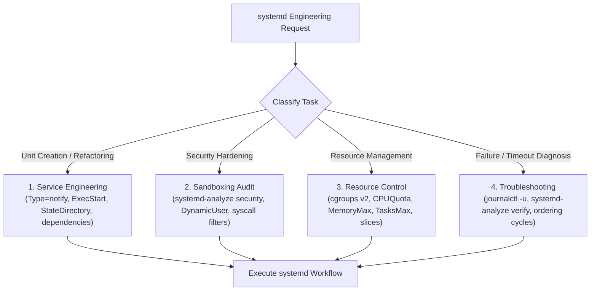

# systemd Systems & Service Engineering

The `systemd-engineering` skill provides specialist capabilities for designing, configuring, hardening, and troubleshooting Linux systemd services, targets, sockets, timers, and resource management slices.

---

## 1. Operating Principles & Invariants

1. **Dependency Does Not Imply Ordering**: Always pair `Wants=` or `Requires=` with explicit `Before=` or `After=` ordering directives to prevent parallel startup race conditions.
2. **Never Blindly Apply Sandboxing**: Hardening directives (`ProtectSystem=strict`, `DynamicUser=yes`) restrict filesystem and capability access. Always pair sandboxing with managed directories (`StateDirectory=`, `RuntimeDirectory=`) and verify required syscalls before deploying.
3. **Validate Statically Before Reloading**: Always validate unit syntax with `systemd-analyze verify /path/to/unit` before requesting system activation.
4. **Safety Tier Gating**: Enabling, disabling, restarting, or masking host system services (`systemctl restart`, `systemctl enable`) are Tier 3 operations requiring explicit human authorization. Never silently disable system services.

---

## 2. Intent Classification & Workflow Routing

---

## 3. The 5-Step Service Hardening Workflow

1. **Baseline Assessment**: Run `systemd-analyze security <unit>` to obtain current exposure score.
2. **Privilege Dropping**: Enforce `NoNewPrivileges=yes` and `DynamicUser=yes` (or specify unprivileged `User=` and `Group=`).
3. **Filesystem Lockdown**: Apply `ProtectSystem=strict`, `ProtectHome=yes`, `PrivateTmp=yes`, and `PrivateDevices=yes`. Declare writable directories via `StateDirectory=` and `RuntimeDirectory=`.
4. **Kernel & Syscall Restriction**: Set `ProtectKernelTunables=yes`, `ProtectControlGroups=yes`, and whitelist syscalls with `SystemCallFilter=@system-service`.
5. **Static Verification**: Execute `systemd-analyze verify` and check that the security exposure score drops below `2.5`.

---

## 4. Cross-Specialist Coordination

| Task | Coordinating Specialists | Interaction |
|:---|:---|:---|
| Packaged service unit file | `systemd-engineering` + `arch-packaging` | `systemd-engineering` authors unit; `arch-packaging` places it in `/usr/lib/systemd/system/`. |
| Network-dependent daemon | `systemd-engineering` + `linux-networking` | `linux-networking` verifies interfaces; `systemd-engineering` orders `After=network-online.target`. |
| Mount or encrypted swap unit | `systemd-engineering` + `linux-storage` | `linux-storage` defines UUIDs/options; `systemd-engineering` configures `.mount` or `.swap`. |

---

## 5. Authoritative References Directory

- [Unit Architecture & Dependency Model](references/unit-architecture.md)
- [Service Engineering & Notification Protocol](references/service-engineering.md)
- [Sandboxing & Security Scoring](references/sandboxing.md)
- [Resource Control & cgroups v2](references/resource-control.md)
- [Diagnostics & Troubleshooting](references/troubleshooting.md)
- [Safety Policy](../../references/safety-policy.md)
