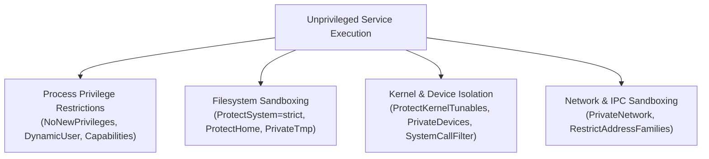

# systemd Sandboxing & Security Scoring Reference

## 1. Scope

This document details systemd sandboxing directives, capability bounding, seccomp syscall filtering, and the methodology for auditing services using `systemd-analyze security`.

---

## 2. Sandboxing Directives Reference



### 2.1 Privilege Isolation
- **`NoNewPrivileges=yes`**: Ensures the service child processes cannot acquire new privileges through `setuid`/`setgid` binaries or filesystem capabilities.
- **`DynamicUser=yes`**: Allocates an ephemeral unprivileged UID/GID (from range 61184-65519) for the lifetime of the service. Automatically implies `ProtectSystem=strict`, `ProtectHome=yes`, and `NoNewPrivileges=yes`.
- **`CapabilityBoundingSet=`**: Drops all Linux capabilities (`CAP_NET_ADMIN`, `CAP_SYS_ADMIN`, `CAP_SETUID`). If the service needs specific capabilities (e.g. binding to port 80 as unprivileged user), declare:
  ```ini
  AmbientCapabilities=CAP_NET_BIND_SERVICE
  CapabilityBoundingSet=CAP_NET_BIND_SERVICE
  ```

### 2.2 Filesystem Sandboxing
- **`ProtectSystem=strict`**: Mounts the entire filesystem hierarchy (`/usr`, `/boot`, `/etc`) read-only for the process. Writable paths must be explicitly permitted via `ReadWritePaths=`, `StateDirectory=`, or `RuntimeDirectory=`.
- **`ProtectHome=yes`**: Makes `/home`, `/root`, and `/run/user` completely inaccessible and empty.
- **`PrivateTmp=yes`**: Mounts an isolated, private `/tmp` and `/var/tmp` namespace unshared with other processes.
- **`PrivateDevices=yes`**: Mounts an isolated `/dev` containing only virtual pseudo-devices (`/dev/null`, `/dev/zero`, `/dev/random`). Physical disk and hardware nodes are hidden.

### 2.3 Kernel & System Call Filtering
- **`ProtectKernelTunables=yes`**: Makes `/proc/sys`, `/sys`, and `/proc/sysrq-trigger` read-only.
- **`ProtectControlGroups=yes`**: Makes the cgroups filesystem `/sys/fs/cgroup` read-only.
- **`ProtectKernelModules=yes`**: Forbids loading or unloading kernel modules via `init_module()` / `finit_module()`.
- **`MemoryDenyWriteExecute=yes`**: Forbids creating memory mappings that are simultaneously writable and executable (`W^X`), preventing buffer overflow shellcode execution.
- **`SystemCallFilter=@system-service`**: Whitelists standard service syscalls while blocking dangerous ones (`@reboot`, `@mount`, `@privileged`). Prefix with `~` to blacklist.
- **`RestrictAddressFamilies=AF_UNIX AF_INET AF_INET6`**: Forbids creating raw packet sockets (`AF_PACKET`) or Netlink sockets (`AF_NETLINK`).

---

## 3. Auditing with `systemd-analyze security`

`systemd-analyze security` audits active or offline service units and calculates an exposure score from `0.0` (optimal) to `10.0` (unhardened/critical):

```bash
# Audit a specific service
systemd-analyze security mydaemon.service
```

### Exposure Scoring Benchmarks:
- **Unhardened service (Score > 8.0)**: Service runs as root with full capabilities, global write access to `/etc` and `/usr`, and open syscall filters.
- **Hardened production service (Score < 2.5)**: Service uses `DynamicUser=yes`, `ProtectSystem=strict`, drops all capabilities, and enforces `SystemCallFilter`.

---

## 4. Authoritative References

- [systemd.exec(5) Manual: Security Settings](https://man.archlinux.org/man/systemd.exec.5#SECURITY_SETTINGS)
- [systemd-analyze(1) Manual](https://man.archlinux.org/man/systemd-analyze.1)
