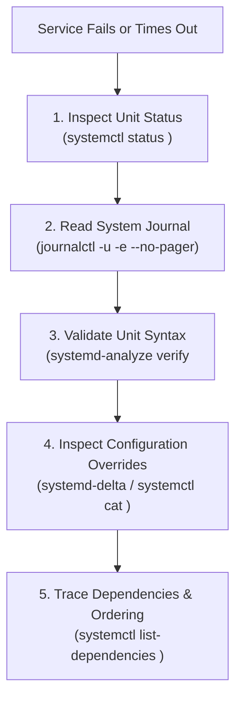

# systemd Service Diagnostics & Troubleshooting Reference

## 1. Scope

This document details diagnostic workflows, failed service isolation, log analysis, configuration validation, and unit delta analysis.

---

## 2. Diagnostic Investigation Workflow



---

## 3. Diagnostic Commands Reference

### 3.1 Unit Validation without Execution
Verify unit syntax, missing directories, or invalid directives without executing the unit:
```bash
systemd-analyze verify /path/to/myunit.service
```

### 3.2 Inspecting Logs with `journalctl`
```bash
# View last 50 lines of logs for a unit
journalctl -u myunit.service -n 50 --no-pager

# View logs from current boot only
journalctl -u myunit.service -b --no-pager

# Follow logs in real time
journalctl -u myunit.service -f
```

### 3.3 Identifying Configuration Overrides (`systemd-delta`)
Check whether local `/etc/systemd/system/` files override vendor units in `/usr/lib/systemd/system/`:
```bash
systemd-delta --type=extended,overridden
```

### 3.4 Boot Performance Analysis
```bash
# Identify services taking longest time during boot
systemd-analyze blame

# Print critical chain graph of slowest startup path
systemd-analyze critical-chain
```

---

## 4. Common Failure Classes & Remediations

| Failure Class | Diagnostic Clue | Root Cause & Remediation |
|:---|:---|:---|
| **Timeout during startup** | `Job for myunit.service failed because a timeout was exceeded.` | Service uses `Type=notify` but binary never calls `sd_notify(0, "READY=1")`, or binary deadlocked before binding port. Switch to `Type=exec` or implement `sd_notify`. |
| **Permission Denied in `/var`** | `open(/var/lib/mydaemon/db): Permission denied` | Service uses `DynamicUser=yes` but lacks `StateDirectory=mydaemon` directive. |
| **Syscall Blocked by Seccomp** | Process terminated with `SIGSYS` (exit code 159). | `SystemCallFilter=` blocked a syscall. Audit journal with `dmesg \| grep SECCOMP` to identify blocked syscall number and add it to filter. |
| **Ordering Cycle Deadlock** | `systemd: Breaking ordering cycle by deleting job...` | Unit A has `After=B` and Unit B has `After=A` (or transitive cycle). Trace with `systemctl list-dependencies`. |

---

## 5. Authoritative References

- [systemctl(1) Manual](https://man.archlinux.org/man/systemctl.1)
- [journalctl(1) Manual](https://man.archlinux.org/man/journalctl.1)
- [systemd-analyze(1) Manual](https://man.archlinux.org/man/systemd-analyze.1)
