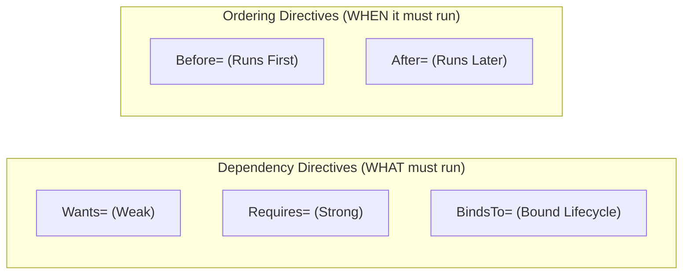

# systemd Unit Architecture & Dependency Model Reference

## 1. Scope

This document details the systemd unit architecture, unit types, dependency graph semantics, and ordering relationships.

---

## 2. Unit Types Overview

| Unit Type | Suffix | Primary Responsibility |
|:---|:---:|:---|
| **Service** | `.service` | Manages daemons, background processes, or one-time batch tasks. |
| **Target** | `.target` | Synchronization point and grouping mechanism for grouping units into system runlevels. |
| **Socket** | `.socket` | Encapsulates IPC/network sockets for socket-activated on-demand services. |
| **Timer** | `.timer` | Cron-like calendar or monotonic event scheduling for triggering services. |
| **Path** | `.path` | Monitors filesystem paths via inotify to trigger service execution upon changes. |
| **Mount** | `.mount` | Controls filesystem mount points (automatically generated from `/etc/fstab`). |
| **Slice** | `.slice` | Organizes cgroups v2 resource hierarchy nodes. |
| **Scope** | `.scope` | Manages externally created transient processes. |

---

## 3. Dependency vs. Ordering Relationships

The most critical rule in systemd engineering is that **dependency relationships do NOT imply ordering**, and **ordering relationships do NOT imply dependency**:

### 3.1 Dependency Directives
- **`Wants=`**: Weak requirement. If unit `B` is in `Wants=` of `A`, activating `A` starts `B`. If `B` fails to start, `A` continues unaffected.
- **`Requires=`**: Strong requirement. If `B` fails to start, `A` is NOT started. However, if `B` stops later, `A` is not stopped automatically (use `BindsTo=` for coupled lifecycles).
- **`BindsTo=`**: Tightly coupled requirement. If `B` stops or fails, `A` is stopped immediately.
- **`PartOf=`**: Propagates restart and stop commands from `B` to `A`.
- **`Conflicts=`**: Negative dependency. If `B` starts, `A` is stopped, and vice-versa.

### 3.2 Ordering Directives
- **`After=`**: Ensures that the current unit starts *after* the listed units finish their startup.
- **`Before=`**: Ensures that the current unit starts *before* the listed units start.

*Anti-Pattern*: Declaring `Requires=foo.service` without `After=foo.service` causes systemd to start both services concurrently in parallel, which leads to race conditions if the second service requires the first to be fully initialized.

---

## 4. Target Units & System States

- **`basic.target`**: Basic system boot (mounts, sockets, sysinit completed).
- **`multi-user.target`**: Standard multi-user non-graphical system state (replaces legacy runlevel 3).
- **`graphical.target`**: Display manager and desktop environment active (replaces legacy runlevel 5).
- **`network.target`**: Indicates that the local network stack is available. Does NOT guarantee routable IP connectivity.
- **`network-online.target`**: Indicates that network management services have obtained an IP address and confirmed routing connectivity. Services requiring remote databases must order `After=network-online.target` and declare `Wants=network-online.target`.

---

## 5. Authoritative References

- [systemd.unit(5) Manual](https://man.archlinux.org/man/systemd.unit.5)
- [systemd.target(5) Manual](https://man.archlinux.org/man/systemd.target.5)
- [systemd Special Targets](https://man.archlinux.org/man/systemd.special.7)
