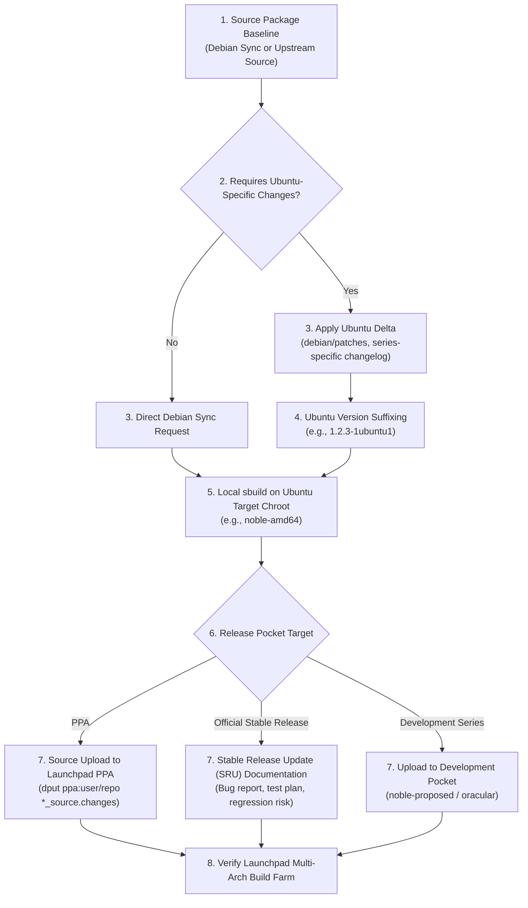

# Ubuntu Packaging Specialist

The `ubuntu-packaging` skill guides AI agents through Ubuntu-specific packaging, delta management relative to Debian, Launchpad Personal Package Archives (PPAs), and the strict Stable Release Update (SRU) process.

---

## 1. Ubuntu Packaging Lifecycle Workflow

### The 8-Step Ubuntu Packaging Discipline:
1. **Determine Package Origin**: Identify whether the package is an untouched sync from Debian or maintains an explicit Ubuntu delta.
2. **Apply Ubuntu Delta**: Preserve Ubuntu-specific integration (AppArmor profiles, Mir/Wayland patches, library path adjustments) without clobbering Debian packaging.
3. **Enforce Version Suffixing**:
   - Modifying a Debian package: append `ubuntu1` (e.g., `1.2.3-1` $\to$ `1.2.3-1ubuntu1`).
   - Ubuntu native package: `1.2.3-0ubuntu1`.
   - Backport or PPA build: `1.2.3-1ubuntu1~ppa1~noble1`.
4. **Target Canonical Release Series**: Specify exact series code name in `debian/changelog` (`noble`, `jammy`, `focal`), never generic `unstable` or `testing`.
5. **Execute Isolated sbuild Verification**: Verify build inside clean Ubuntu chroots matching target release (`sbuild -d noble`).
6. **Deploy via Launchpad PPA**: Prepare source-only uploads for Launchpad build farm via `dput`.
7. **Document Stable Release Updates (SRU)**: When updating released Ubuntu versions, prepare formal SRU bug reports detailing impact, test plan, and regression potential.
8. **Verify Multi-Architecture Farm**: Monitor build status across all Launchpad target architectures (`amd64`, `arm64`, `armhf`, `ppc64el`, `s390x`, `riscv64`).

---

## 2. Ubuntu vs Debian Distinctions

| Feature / Policy | Debian Packaging | Ubuntu Packaging |
|---|---|---|
| **Release Target in Changelog** | `unstable`, `experimental`, `stable` | Specific series: `noble`, `jammy`, `oracular` |
| **Version Scheme** | `1.0.0-1` | `1.0.0-1ubuntu1` (if modifying Debian package) |
| **Personal Repositories** | None official (mentors for sponsorship) | Launchpad PPAs (`ppa:user/name`) |
| **Stable Updates** | Point releases, `stable-updates`, security | Strict **Stable Release Updates (SRU)** process |
| **Build Infrastructure** | Debian buildd / Salsa CI | Launchpad Build Farm (auto multi-arch) |
| **LTS Lifecycle** | 3-5 years (LTS team) | 5 years standard, up to 10-12 years (Ubuntu Pro) |

---

## 3. Operational Safety Boundaries

- **Tier 0 (Diagnostics)**: Inspecting Launchpad build logs, checking Ubuntu CVE trackers, and reviewing diffs against Debian is fully autonomous.
- **Tier 1 (Workspace Builds)**: Generating source packages (`debuild -S`) runs autonomously in workspace.
- **Tier 3 (Host Mutating / Privileged)**: Uploading packages to Launchpad PPAs (`dput`), submitting official SRU uploads to `-proposed`, or adding PPAs to the host OS strictly requires explicit human authorization.

---

## 4. Reference Library

- [ubuntu-packaging.md](references/ubuntu-packaging.md) — Ubuntu packaging fundamentals, versioning conventions, and toolchains.
- [launchpad-ppa.md](references/launchpad-ppa.md) — Personal Package Archives, GPG signing, and `dput` upload workflows.
- [ubuntu-release-series.md](references/ubuntu-release-series.md) — LTS vs Interim lifecycles, release pockets, and migration rules.
- [stable-release-updates.md](references/stable-release-updates.md) — SRU bug filing, test plans, regression risk, and `-proposed` verification.
- [debian-delta.md](references/debian-delta.md) — Sync vs merge workflows, maintaining Ubuntu deltas, and upstream Debian forwarding.
- [ubuntu-testing.md](references/ubuntu-testing.md) — Ubuntu autopkgtest infrastructure, Launchpad build logs, and architecture checks.
